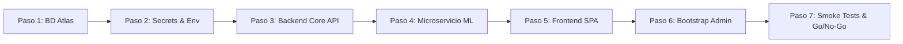
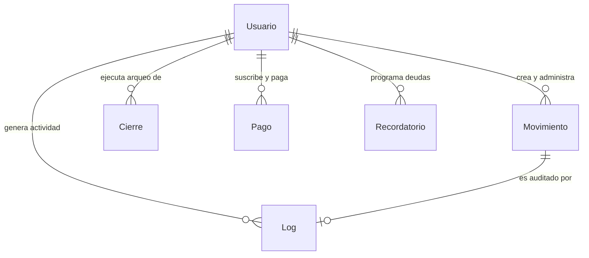

DOCUMENTO DE GESTIÓN TECNOLÓGICA
# PLAN DE DESPLIEGUE DE SOFTWARE
### Modelo de implementación y puesta en producción | Versión 1.3.0

* **Proyecto / sistema:** FinanceFlow — Sistema de Gestión Financiera & Balance Contable con IA  
* **Organización:** FinanceFlow Inc. / KrCrimson  
* **Fecha:** 22/10/2026  
* **Responsable del plan:** Equipo de Arquitectura, DevOps y Calidad  
* **Ambiente de destino:** Producción (Cloud Híbrido: MongoDB Atlas + Render + Vercel)

---

## 1. Propósito y descripción

Establecer un procedimiento controlado, reproducible y verificable para liberar e implementar la versión **1.3.0** del software **FinanceFlow** en el ambiente de producción objetivo, minimizando interrupciones de servicio, errores de configuración, inconsistencias o pérdida de datos financieros y riesgos de seguridad de la información. 

El presente plan define las condiciones previas, la arquitectura distribuida del sistema, el aprovisionamiento de la base de datos documental desde cero, el modelado y conceptos de los documentos NoSQL, la generación y administración de variables de entorno y secretos criptográficos, la secuencia operativa de despliegue de los servicios (Backend Core, Microservicio ML/OCR y Frontend SPA), las pruebas de humo y validación go/no-go, las responsabilidades de los intervinientes, los mecanismos de comunicación y las acciones de contingencia y reversión (rollback).

---

## 2. Objetivos

* **Garantizar la correcta instalación y vinculación:** Desplegar la versión autorizada de FinanceFlow con todas sus dependencias de sistema (Node.js 18+, Python 3.10, Tesseract OCR), librerías y configuraciones de red y variables de entorno validadas.
* **Preservar la seguridad, confidencialidad e integridad:** Asegurar el cifrado de datos en reposo y tránsito (TLS 1.3), manejo estricto de CORS, validaciones sintácticas con Zod, firma de JWT de alta entropía (>= 32 caracteres) y protección contra fugas de datos sensibles en bitácoras.
* **Aprovisionar la persistencia sin estado previo:** Construir el clúster documental en MongoDB Atlas desde cero, estableciendo usuarios de aplicación con privilegios acotados, reglas de firewall y los índices únicos y compuestos necesarios para la coherencia contable.
* **Validar los flujos críticos de negocio:** Ejecutar pruebas de humo exhaustivas sobre autenticación RBAC, registro de movimientos contables, arqueo y cierre de caja chica, checkout de pagos vía Culqi y análisis predictivo de comprobantes antes de habilitar el tráfico a usuarios finales.
* **Disponer de un plan de contingencia probado:** Mantener una estrategia de rollback y respaldo integral para restituir el estado operativo anterior en caso de fallos no recuperables dentro de la ventana de cambio.

---

## 3. Alcance y supuestos

### Alcance
El alcance de este despliegue abarca:
1. Aprovisionamiento y configuración de seguridad de la base de datos en MongoDB Atlas.
2. Inyección y validación de matrices de variables de entorno para Backend, Microservicio de IA y Frontend.
3. Despliegue y compilación del Backend Core (API REST Express 5 en Render / VPS PM2).
4. Despliegue y containerización Docker del Microservicio de Machine Learning & OCR (FastAPI / OpenCV / Tesseract).
5. Compilación optimizada y distribución Edge del Frontend SPA (React 18 en Vercel con reglas de enrutamiento).
6. Ejecución del script de inicialización y siembra del usuario Superadministrador.
7. Pruebas técnicas, funcionales, pruebas de humo y verificación de observabilidad con Sentry.
8. Monitoreo posterior, soporte inicial y cierre formal del despliegue.

*Exclusiones:* No incluye la refactorización de código no probado, cambios en contratos de API no acordados ni la liberación de funcionalidades fuera del Sprint 7 de FinanceFlow.

### Supuestos
* Se cuenta con el repositorio de código fuente congelado y certificado en GitHub (etiqueta `v1.3.0`).
* Las cuentas institucionales en MongoDB Atlas, Render, Vercel, Culqi y Brevo/Resend están activas y con cuotas vigentes.
* Se dispone de una ventana de mantenimiento programada y aprobada por el Propietario del Servicio.
* Los responsables técnicos de cada componente se encuentran disponibles durante la ventana de ejecución.

---

## 4. Estrategia de despliegue

La estrategia general contempla un despliegue gradual por etapas que desacopla la persistencia, los servicios backend y la interfaz de usuario:



### Tabla de Definición de la Estrategia

| Elemento | Definición para FinanceFlow v1.3.0 |
| :--- | :--- |
| **Tipo de despliegue** | **Directo con validación previa (Blue-Green nativo en Vercel y Rolling en Render)**. El frontend utiliza conmutación atómica instantánea de alias una vez compilado; el backend provisiona el nuevo contenedor y conmuta el balanceador tras pasar el health check. |
| **Versión / paquete** | `v1.3.0` — Commit SHA inmutable de la rama `main` en `KrCrimson/FinanceFlow`. |
| **Servicios afectados** | Base de Datos MongoDB Atlas (`financeflow`), API Backend Express (`/api/*`), Microservicio FastAPI ML (`/categorize`, `/analyze-receipt`), Frontend Web React SPA, Pasarelas Culqi / Brevo. |
| **Ventana programada** | Sábado 24 de Octubre de 2026, 22:00 a 23:30 (UTC-5). |
| **Interrupción esperada** | **Máximo 5 minutos de degradación momentánea** en solicitudes en tránsito durante el reinicio de conexión del backend; el frontend y la base de datos operan sin tiempo de inactividad visible. |
| **Criterio para avanzar** | Conexión exitosa a MongoDB, respuesta HTTP 200 en `/api/usuarios/login`, predicción ML válida y 100% de pruebas de humo superadas. |

---

## 5. Roles y responsabilidades

| Rol | Responsable | Responsabilidad principal |
| :--- | :--- | :--- |
| **Líder de despliegue** | Líder Técnico / Release Manager | Coordina el cronograma, registra hitos de inicio y fin, verifica autorizaciones y declara la decisión formal de Go / No-Go o Rollback. |
| **Equipo DevOps / Backend** | Ingeniero Backend & Cloud | Aprovisiona el clúster MongoDB Atlas, configura las variables de entorno en Render/VPS, ejecuta el despliegue del API y el microservicio Docker, y ejecuta scripts de migración/bootstrap. |
| **Equipo Frontend** | Desarrollador Frontend Senior | Configura el proyecto en Vercel, valida variables de entorno `REACT_APP_*`, compila el bundle estático y comprueba las reglas de reescritura SPA (`vercel.json`). |
| **Infraestructura y Base de Datos** | Administrador de Base de Datos (DBA) | Valida dimensionamiento del clúster, reglas de firewall de red, índices compuestos únicos y mecanismos de respaldo (`mongodump`). |
| **Calidad (QA) / Usuario Clave** | Ingeniero de QA | Ejecuta el protocolo de pruebas de humo funcionales y técnicas (autenticación, registro contable, arqueo de cierres, pagos y OCR). |
| **Seguridad de la Información** | Auditor de Seguridad | Verifica la no exposición de secretos en repositorios, políticas de contraseñas, longitud de llaves JWT y ausencia de vulnerabilidades IDOR. |
| **Propietario del Servicio / CAB** | Product Owner / Comité de Cambios | Aprueba la ventana de cambio, evalúa el impacto en el negocio y otorga la conformidad final de puesta en marcha. |

---

## 6. Prerrequisitos y condiciones de entrada

Para dar inicio formal a la ventana de despliegue, deben cumplirse obligatoriamente las siguientes condiciones de entrada:

1. **Aprobación Formal:** Solicitud de cambio y plan de despliegue autorizados por el Propietario del Servicio.
2. **Control de Versiones:** Rama `main` congelada, tag `v1.3.0` generado; suites de pruebas unitarias locales y de integración pasando al 100% (12 suites, 29 tests superados).
3. **Plataformas de Infraestructura Listas:**
   * Cuenta y permisos de administración en MongoDB Atlas con organización verificada.
   * Cuenta activa en Render vinculada al repositorio GitHub de FinanceFlow.
   * Proyecto configurado en Vercel con integración a GitHub.
4. **Secretos Criptográficos Listos para Inyección:**
   * Llave `JWT_SECRET` generada criptográficamente (mínimo 32 caracteres hexadecimales).
   * Llaves de Culqi de producción (`sk_live_...` y `pk_live_...`) o desarrollo (`sk_test_...` y `pk_test_...`).
   * API Key de Brevo (`xkeysib-...`) o Resend para correos transaccionales.
   * API Key de Google Gemini (`GEMINI_API_KEY`) para visión artificial fallback.
5. **Comunicaciones Emitidas:** Notificación preventiva enviada a las partes interesadas con aviso de la ventana de cambio programada.

---

## 7. Procedimiento operativo de implementación

### 7.1. Matriz de Fases de Ejecución

| Fase | Actividad / Descripción | Evidencia esperada |
| :--- | :--- | :--- |
| **1. Preparación** | Validar checklist técnico, confirmar congelamiento de código, verificar disponibilidad de responsables y abrir canal de comunicación en vivo. | Acta / ticket de inicio de cambio |
| **2. Salvaguarda** | En entornos con datos preexistentes, generar respaldo lógico con `mongodump` y exportar variables de entorno previas. | Archivo comprimido `backup_*.gz` verificado |
| **3. Prechequeo** | Comprobar conectividad hacia MongoDB Atlas, disponibilidad de endpoints de terceros (Culqi, Brevo, Gemini) y certificados TLS. | Check de conectividad en terminal (HTTP/Mongo OK) |
| **4. Ejecución** | Aprovisionar BD, inyectar variables de entorno, desplegar Backend Core, microservicio ML y Frontend SPA; ejecutar bootstrap del administrador. | Logs de build de Render y Vercel en estado *Live* |
| **5. Verificación** | Ejecutar pruebas de humo automatizadas y manuales sobre autenticación, balance contable, cierre de caja, checkout y OCR. | Matriz de pruebas de humo 100% aprobada |
| **6. Habilitación** | Actualizar orígenes CORS cruzados, habilitar tráfico de producción al dominio final y emitir confirmación de servicio disponible. | Acceso operativo desde `https://financeflow.vercel.app` |
| **7. Estabilización** | Monitoreo reforzado de métricas en Sentry, latencia de solicitudes en Render y tasa de errores durante las primeras 24-48 horas. | Panel de observabilidad sin anomalías críticas |
| **8. Cierre** | Documentar resultados, registrar lecciones aprendidas, archivar evidencias y firmar acta de conformidad formal. | Acta de cierre aprobada por el CAB |

---

### 7.2. Procedimiento Técnico Paso a Paso (Desde Cero)

#### PASO 1: Creación y Configuración de la Base de Datos (MongoDB Atlas)
1. **Crear Clúster:**
   - Inicie sesión en [cloud.mongodb.com](https://cloud.mongodb.com).
   - Cree un nuevo proyecto denominado `FinanceFlow-Production`.
   - Seleccione **Create a Deployment** → Elegir clúster **M0 Free Tier** (pruebas/piloto) o **M10 Dedicated** (producción) en región `AWS us-east-1` o `sa-east-1`.
   - Nombre del clúster: `financeflow-cluster`.
2. **Crear Usuario de Aplicación (Database Access):**
   - Vaya a **Security** → **Database Access** → **Add New Database User**.
   - Método de autenticación: `Password`.
   - Usuario: `financeflow_app`.
   - Contraseña: Generar clave aleatoria robusta de al menos 24 caracteres sin caracteres conflictivos con URLs.
   - Privilegios: `Read and write to any database` (o restringido a la base `financeflow`).
3. **Configurar Reglas de Firewall (Network Access):**
   - Vaya a **Security** → **Network Access** → **Add IP Address**.
   - Para servicios PaaS (Render/Vercel): Añadir `0.0.0.0/0` (Allow Access from Anywhere) con comentario `Acceso PaaS Render/Vercel`. *(Protegido por autenticación SCRAM-SHA-256 TLS).*
   - Para servidores VPS dedicados: Añadir la dirección IP estática fija del VPS (ej. `198.51.100.45/32`).
4. **Obtener Connection String:**
   - En el clúster, hacer clic en **Connect** → **Drivers** (Node.js).
   - La cadena resultante debe estructurarse indicando la base de datos `financeflow`:
     ```text
     mongodb+srv://financeflow_app:<PASSWORD>@financeflow-cluster.xxxx.mongodb.net/financeflow?retryWrites=true&w=majority
     ```

#### PASO 2: Generación de Secretos y Configuración de Variables de Entorno

1. **Generación Criptográfica de Secretos:**
   Ejecute en su terminal local para generar el `JWT_SECRET` y el `ML_API_KEY`:
   ```bash
   node -e "console.log(require('crypto').randomBytes(32).toString('hex'))"
   ```
   *Ejemplo de llave generada:* `9f8e21a44c7b8e19d3f58a71c3e44b910e527a9420b7e193ca8e9527cf6814b2`

2. **Matriz de Variables del Backend Core (`backend/.env`):**
   ```ini
   NODE_ENV=production
   PORT=5000
   MONGODB_URI=mongodb+srv://financeflow_app:<PASSWORD>@financeflow-cluster.xxxx.mongodb.net/financeflow?retryWrites=true&w=majority
   JWT_SECRET=9f8e21a44c7b8e19d3f58a71c3e44b910e527a9420b7e193ca8e9527cf6814b2
   CORS_ORIGIN=https://financeflow.vercel.app
   FRONTEND_URL=https://financeflow.vercel.app
   CULQI_SECRET_KEY=sk_live_tu_llave_privada_culqi
   BREVO_API_KEY=xkeysib-tu_api_key_de_brevo
   EMAIL_USER=soporte@financeflow.com
   GEMINI_API_KEY=AIzaSyTuClaveDeGemini
   SENTRY_DSN=https://tu_dsn_backend_sentry
   ```

3. **Matriz de Variables del Frontend SPA (`frontend/.env`):**
   ```ini
   REACT_APP_API_URL=https://financeflow-backend.onrender.com
   REACT_APP_ML_URL=https://financeflow-ml.onrender.com
   REACT_APP_CULQI_PUBLIC_KEY=pk_live_tu_llave_publica_culqi
   REACT_APP_ENABLE_SDK=true
   REACT_APP_SENTRY_DSN=https://tu_dsn_frontend_sentry
   ```

4. **Matriz de Variables del Microservicio ML (`ml_backend/.env`):**
   ```ini
   PORT=8000
   ML_API_KEY=ml_sec_tu_clave_secreta_para_fastapi
   ```

#### PASO 3: Despliegue del Backend Core en Render
1. Inicie sesión en [Render Dashboard](https://dashboard.render.com) → **New +** → **Web Service**.
2. Conecte el repositorio `FinanceFlow`.
3. Configure los parámetros:
   * **Name:** `financeflow-backend`
   * **Root Directory:** `backend` *(Obligatorio)*
   * **Runtime:** `Node`
   * **Build Command:** `npm install`
   * **Start Command:** `npm start`
4. En **Environment Variables**, ingrese todas las variables del Paso 2 para el backend.
5. Inicie el despliegue y confirme en los logs:
   ```text
   MongoDB conectado
   Servidor backend escuchando en puerto 10000
   ```
6. Guarde la URL asignada: `https://financeflow-backend.onrender.com`.

#### PASO 4: Despliegue del Microservicio ML (FastAPI / Docker) en Render
1. En Render Dashboard → **New +** → **Web Service** → Seleccionar repositorio `FinanceFlow`.
2. Configure los parámetros:
   * **Name:** `financeflow-ml`
   * **Root Directory:** `ml_backend`
   * **Runtime:** `Docker` *(Render detectará el `Dockerfile` con Python 3.10 y `tesseract-ocr`)*
3. En **Environment Variables**:
   * `PORT`: `8000`
   * `ML_API_KEY`: El token configurado en el Paso 2.
4. Despliegue y guarde la URL: `https://financeflow-ml.onrender.com`.

#### PASO 5: Despliegue del Frontend Web en Vercel
1. Inicie sesión en [Vercel](https://vercel.com) → **Add New...** → **Project** → Importar `FinanceFlow`.
2. Configuración:
   * **Framework Preset:** `Create React App`
   * **Root Directory:** `frontend` *(Hacer clic en Edit y seleccionarla)*
   * **Build Command:** `npm run build`
   * **Output Directory:** `build`
3. En **Environment Variables**, añada las variables del Frontend del Paso 2 (`REACT_APP_API_URL`, `REACT_APP_CULQI_PUBLIC_KEY`, etc.).
4. Haga clic en **Deploy**.
5. Verifique que el archivo `frontend/vercel.json` asegure las rutas SPA:
   ```json
   {
     "rewrites": [
       { "source": "/(.*)", "destination": "/index.html" }
     ]
   }
   ```
6. Obtenga el dominio generado (ej. `https://financeflow.vercel.app`) y actualice las variables `CORS_ORIGIN` y `FRONTEND_URL` en el backend en Render para cerrar el ciclo de seguridad.

#### PASO 6: Inicialización del Sistema y Creación del Superadministrador
Con la base de datos vacía, ejecute el siguiente script desde la consola de comandos del backend para sembrar el usuario administrativo inicial:

```bash
cd backend
node -e "
const mongoose = require('mongoose');
const bcrypt = require('bcryptjs');
require('dotenv').config();

const usuarioSchema = new mongoose.Schema({
  nombre: String,
  email: { type: String, unique: true, lowercase: true },
  passwordHash: String,
  rol: String,
  estado: String,
  fondoFijo: Number,
  esPremium: Boolean,
  planTipo: String,
  creadoEn: { type: Date, default: Date.now },
  actualizadoEn: { type: Date, default: Date.now }
});

const Usuario = mongoose.models.Usuario || mongoose.model('Usuario', usuarioSchema);

async function bootstrap() {
  await mongoose.connect(process.env.MONGODB_URI);
  console.log('✅ Conexión exitosa con MongoDB Atlas');

  const adminEmail = 'admin@financeflow.com';
  const rawPassword = 'AdminPasswordSeguro2026!'; // Modificar en su implementación real

  const existe = await Usuario.findOne({ email: adminEmail });
  if (existe) {
    console.log('⚠️ El usuario administrador ya existe:', adminEmail);
    process.exit(0);
  }

  const passwordHash = await bcrypt.hash(rawPassword, 10);
  const nuevoAdmin = new Usuario({
    nombre: 'Super Administrador',
    email: adminEmail,
    passwordHash: passwordHash,
    rol: 'admin',
    estado: 'activo',
    fondoFijo: 1000,
    esPremium: true,
    planTipo: 'pro'
  });

  await nuevoAdmin.save();
  console.log('🎉 Superadministrador creado exitosamente:');
  console.log('   Email:', adminEmail);
  console.log('   Rol:', nuevoAdmin.rol);
  console.log('   Plan:', nuevoAdmin.planTipo);
  process.exit(0);
}

bootstrap().catch(err => {
  console.error('❌ Error creando admin:', err);
  process.exit(1);
});
"
```

---

## 8. Cronograma referencial

| Hito | Momento referencial | Responsable |
| :--- | :--- | :--- |
| **Revisión y aprobación del plan** | T − 5 a T − 1 días | Líder de despliegue / Propietario del Servicio |
| **Aprovisionamiento BD y prechequeos** | T − 60 a T − 15 min | DevOps / DBA |
| **Inyección de variables y despliegue backend** | T 0 a T + 25 min | Equipo Backend |
| **Despliegue ML y compilación frontend** | T + 25 a T + 45 min | DevOps / Frontend |
| **Bootstrap admin y pruebas de humo (Go/No-Go)** | T + 45 a T + 75 min | QA / Líder de despliegue |
| **Apertura de tráfico y monitoreo reforzado** | Primeras 24–48 horas | Equipo de Operaciones |
| **Cierre formal del despliegue** | T + 2 días | Líder de despliegue |

---

## 9. Pruebas y criterios de aceptación

Para validar la liberación en producción, se deben verificar y documentar los siguientes criterios:

* **Disponibilidad:** Servicios backend (`https://financeflow-backend.onrender.com`), microservicio ML y frontend SPA reportan estado 200 OK y tiempos de respuesta < 800 ms.
* **Funcionalidad (Smoke Tests):**
  1. *Autenticación:* Login exitoso con el usuario administrador retornando token JWT firmado.
     ```bash
     curl -s -X POST https://financeflow-backend.onrender.com/api/usuarios/login \
       -H "Content-Type: application/json" \
       -d '{"email": "admin@financeflow.com", "password": "AdminPasswordSeguro2026!"}'
     ```
  2. *Gestión Financiera:* Creación y consulta de un movimiento contable (ingreso y egreso).
  3. *Arqueo de Caja Chica:* Ejecución de cierre diario sin discrepancias matemáticas.
  4. *Inferencia de IA:* Clasificación predictiva de un gasto mediante el microservicio ML.
     ```bash
     curl -s -X POST https://financeflow-ml.onrender.com/categorize \
       -H "Content-Type: application/json" \
       -H "x-api-key: <ML_API_KEY>" \
       -d '{"description": "Almuerzo Restaurante", "amount": 35.00}'
     ```
* **Datos:** Clúster MongoDB con colecciones creadas (`usuarios`, `movimientos`, `cierres`, `pagos`, `recordatorios`, `logs`) e índice compuesto `{ userId: 1, tipo: 1, periodo: 1 }` activo.
* **Seguridad:** Comunicaciones bajo protocolo HTTPS estricto; encabezados de seguridad de Helmet activos; orígenes CORS no autorizados rechazados con error 500/CORS.
* **Rendimiento:** Tasa de errores HTTP 5xx menor al 0.1% durante las pruebas de carga iniciales.
* **Operación:** Captura de eventos operativa en Sentry y bitácora de logs registrando acciones de usuario.

**Criterio de aceptación final:** El Propietario del Servicio y el responsable de QA confirman formalmente los resultados satisfactorios de las pruebas de humo y autorizan la continuidad definitiva de la versión v1.3.0 en producción.

---

## 10. Riesgos, contingencia y reversión

| Riesgo Identificado | Impacto | Mitigación / Respuesta Operativa |
| :--- | :---: | :--- |
| **Incompatibilidad de configuración en variables de entorno** | Alto | Validación automática de arranque en `app.js` (si `JWT_SECRET` tiene menos de 32 caracteres, el proceso aborta explícitamente); uso de plantilla `.env.production` pre-auditada. |
| **Bloqueo de conexión a MongoDB Atlas (Firewall / Timeout)** | Crítico | Regla de red `0.0.0.0/0` validada previamente en MongoDB Atlas; verificación previa con script `test_connection.js`. |
| **Fallo en compilación del microservicio de Visión ML** | Medio | Uso de contenedor Docker con base probada `python:3.10-slim` e instalación declarativa de `tesseract-ocr` y `tesseract-ocr-spa`. En caso de fallo, el backend conmuta automáticamente al OCR multimodal de Google Gemini. |
| **Discrepancia de orígenes CORS entre frontend y backend** | Alto | Inclusión de regex para permitir previews de Vercel y asignación explícita de `CORS_ORIGIN` en el panel de Render antes de habilitar accesos. |
| **Fallas en despacho de correos SMTP tradicionales** | Medio | Arquitectura con fallback automático a la API REST HTTP de Brevo (`BREVO_API_KEY`) que opera sobre el puerto 443 estándar, evitando bloqueos de puertos 25/465. |

---

## 11. Procedimiento de rollback

### Activadores de Rollback:
Se declarará de forma inmediata el procedimiento de retorno a la versión anterior si ocurre cualquiera de los siguientes eventos:
1. Imposibilidad de conectar a la base de datos o fallos críticos en la persistencia transaccional tras 30 minutos de iniciada la ventana.
2. Tasa de errores HTTP 500 superior al 5% en rutas de autenticación o movimientos financieros.
3. Fuga comprobada de secretos, llaves maestras o vulnerabilidad crítica de seguridad no contenida.
4. Incumplimiento no subsanable de los criterios de aceptación en la ventana límite autorizada (T + 75 min).

### Pasos Operativos de Rollback:
1. **Declaración Oficial:** El Líder de Despliegue declara formalmente la condición de "No-Go / Rollback", registra la hora exacta y notifica al equipo por el canal operativo.
2. **Reversión del Frontend (Vercel):**
   - Ingrese al panel de Vercel → **Deployments**.
   - Localice el despliegue previo estable y haga clic en **Instant Rollback**. Vercel restaurará el tráfico de los usuarios en menos de 10 segundos.
3. **Reversión del Backend (Render):**
   - Ingrese a Render Dashboard → Servicio Backend → Pestaña **Events**.
   - Seleccione el commit anterior estable y haga clic en **Rollback to this revision**.
4. **Tratamiento de la Base de Datos:**
   - Si se realizaron mutaciones corruptas o incompatibles durante las pruebas de la nueva versión, ejecute la restauración del respaldo previo:
     ```bash
     mongorestore --uri="mongodb+srv://financeflow_app:<PASSWORD>@financeflow-cluster.xxxx.mongodb.net/financeflow" \
                  --archive="backup_previo.gz" --gzip --drop
     ```
   - *Advertencia:* La opción `--drop` elimina las colecciones antes de restaurar; esta acción requiere la autorización expresa del Propietario del Servicio.
5. **Verificación de Estabilidad y Cierre de Incidente:**
   - Verifique que la versión previa responda con normalidad.
   - Abra el ticket de incidente post-mortem para documentar la causa raíz y reprogramar la ventana de liberación.

---

## 12. Plan de comunicación y soporte

| Momento | Destinatarios | Mensaje / Canal Oficial |
| :--- | :--- | :--- |
| **Antes (T − 24 horas)** | Áreas usuarias, soporte al cliente y directivos | Notificación formal de ventana de mantenimiento programado; aviso de posible degradación breve de 5 minutos vía correo / ticket. |
| **Inicio (T 0)** | Equipo técnico y responsables de despliegue | Confirmación de inicio de ventana y apertura de sesión de coordinación técnica en vivo. |
| **Fin Exitoso (T + 75 min)** | Usuarios y partes interesadas | Notificación de puesta en producción exitosa de FinanceFlow v1.3.0, nuevas capacidades disponibles y canales de soporte habilitados. |
| **Fin con Reversión (En caso de fallo)** | Usuarios y directivos | Comunicado de restitución del servicio en su versión anterior sin impacto en datos; aviso de reprogramación. |
| **Estabilización (Primeras 48 h)** | Mesa de ayuda y equipo de operaciones | Reporte diario de estado, volumen de transacciones procesadas, incidentes menores resueltos y métricas de satisfacción. |

---

## 13. Evidencias y entregables

Al concluir el proceso de despliegue, deben quedar archivados los siguientes artefactos:
* Ticket de control de cambios con las firmas y aprobaciones correspondientes.
* Registro del hash o tag inmutable de Git desplegado (`v1.3.0`).
* Archivo de respaldo de la base de datos previo al despliegue (`backup_*.gz`).
* Registros (logs) de build y despliegue exitoso exportados desde Render y Vercel.
* Reporte documentado con los resultados del protocolo de pruebas de humo.
* Tablero de telemetría de Sentry confirmando la captura de eventos sin errores críticos activos.
* Acta de cierre y conformidad firmada por el Propietario del Servicio.

---

## 14. Matriz breve de aprobación

| Instancia | Nombre y Cargo | Fecha | Conformidad |
| :--- | :--- | :---: | :---: |
| **Elaborado por** | Equipo de Arquitectura & DevOps | 22/10/2026 | Aprobado |
| **Revisado por (Técnico / Seguridad)** | Auditor de Seguridad y Calidad (QA) | 22/10/2026 | Aprobado |
| **Autorizado por (Propietario / CAB)** | Propietario del Servicio / Product Owner | 22/10/2026 | Aprobado |

---

## Anexo A. Lista de verificación go/no-go

Antes de habilitar el tráfico público definitivo, marque cada una de las siguientes casillas:

* [x] Cambio aprobado y ventana de mantenimiento confirmada.
* [x] Respaldo de seguridad comprobado y procedimiento de rollback disponible.
* [x] Clúster de MongoDB Atlas aprovisionado con usuario de aplicación y reglas de red activas.
* [x] Paquete de código fuente y dependencias validadas (`npm audit`, pruebas pasando al 100%).
* [x] Variables de entorno inyectadas con `JWT_SECRET` criptográfico de alta entropía (>= 32 caracteres).
* [x] Microservicio de Machine Learning containerizado y respondiendo inferencias.
* [x] Frontend compilado en Vercel con reglas de reescritura para rutas SPA (`vercel.json`).
* [x] Usuario Superadministrador inicial inicializado con contraseña encriptada con bcrypt.
* [x] Pruebas críticas de humo ejecutadas exitosamente (Login, Movimiento, Cierre, Pago, OCR).
* [x] Monitoreo activo y alertas verificadas en Sentry.
* [x] Autorización expresa del Propietario del Servicio para habilitar producción.

---

## Anexo B. Diccionario de Datos y Conceptos de los Documentos NoSQL

En el motor documental MongoDB, la persistencia se gestiona en **colecciones de documentos BSON (Binary JSON)** gobernadas por esquemas de **Mongoose**, proporcionando flexibilidad de esquema con validación estricta de tipos e integridad referencial mediante `ObjectId`.

A continuación se detalla la arquitectura de las **6 colecciones** de FinanceFlow:



### 1. Colección: `usuarios` (Modelo: `Usuario`)
Representa las identidades del sistema, credenciales de acceso, control de roles (RBAC), nivel de suscripción comercial y cuotas de consumo de IA.
* `_id` (`ObjectId`): Clave primaria inmutable.
* `nombre` (`String`, Requerido): Nombre de la persona o comercio.
* `email` (`String`, Requerido, Único, Lowercase): Correo electrónico identificador de la cuenta.
* `passwordHash` (`String`, Requerido): Contraseña cifrada con algoritmo **bcrypt** (10 salt rounds).
* `estado` (`String`, Enum: `['activo', 'inactivo']`, Default: `'activo'`): Estado de habilitación de la cuenta.
* `rol` (`String`, Enum: `['user', 'admin']`, Default: `'user'`): Permisos en la plataforma.
* `fondoFijo` (`Number`, Default: `1000`): Monto base asignado para arqueo de caja chica.
* `resetPasswordToken` (`String`, Opcional): Hash para recuperación de clave.
* `resetPasswordExpires` (`Date`, Opcional): Fecha y hora límite de caducidad del token (TTL).
* `esPremium` (`Boolean`, Default: `false`): Flag de privilegios Pro.
* `planTipo` (`String`, Enum: `['free', 'pro']`, Default: `'free'`): Tipo de suscripción.
* `conteoOcrMes` (`Number`, Default: `0`): Contador mensual de comprobantes procesados con OCR.
* `ultimoReinicioOcr` (`Date`, Default: `Date.now`): Fecha de último reseteo del ciclo de cuotas.
* `lastPaymentId` (`String`, Opcional): Identificador de la última transacción de pago procesada.
* `creadoEn` / `actualizadoEn` (`Date`): Marcas temporales de auditoría (Hook `pre('save')`).

### 2. Colección: `movimientos` (Modelo: `Movimiento`)
Registra las transacciones contables operativas de la entidad económica.
* `_id` (`ObjectId`): Clave primaria.
* `tipo` (`String`, Enum: `['ingreso', 'egreso']`, Requerido): Naturaleza contable.
* `nombre` (`String`, Requerido): Descripción o glosa del movimiento.
* `monto` (`Number`, Requerido, min: `0`): Importe monetario en moneda local.
* `categoria` (`String`, Requerido): Clasificación analítica (ej. `Ventas`, `Comida`, `Alquiler`).
* `userId` (`ObjectId`, Ref: `Usuario`, Requerido): Vínculo foráneo que garantiza aislamiento multi-tenant.
* `fecha` (`Date`, Requerido): Fecha contable de ocurrencia.
* `estado` (`String`, Enum: `['activo', 'inactivo', 'planificado']`, Default: `'activo'`): Estado del registro.
* `esRecurrente` (`Boolean`, Default: `false`): Indica si el registro se repite periódicamente.
* `creadoEn` / `actualizadoEn` (`Date`): Auditoría temporal.

### 3. Colección: `cierres` (Modelo: `Cierre`)
Control de arqueos de balance periódico (diario o mensual) que congelan períodos auditados.
* `_id` (`ObjectId`): Clave primaria.
* `userId` (`ObjectId`, Ref: `Usuario`, Requerido): Usuario responsable del arqueo.
* `tipo` (`String`, Enum: `['diario', 'mensual']`, Requerido): Período liquidado.
* `periodo` (`String`, Requerido): Formato `"YYYY-MM-DD"` para diarios o `"YYYY-MM"` para mensuales.
* `fondoFijo` (`Number`, Requerido): Base pactada de caja.
* `ingresosTotales` (`Number`, Requerido): Sumatoria matemática de ingresos en el período.
* `egresosTotales` (`Number`, Requerido): Sumatoria matemática de egresos en el período.
* `saldoEsperado` (`Number`, Requerido): Cálculo formal: `fondoFijo + ingresosTotales - egresosTotales`.
* `saldoFisico` (`Number`, Requerido): Arqueo real declarado por el operador.
* `diferencia` (`Number`, Requerido): `saldoFisico - saldoEsperado` (cuadre o descalce).
* `comentarios` (`String`): Justificación de descuadres.
* **Índice Compuesto Único:** `{ userId: 1, tipo: 1, periodo: 1 }` con restricción `{ unique: true }`.

### 4. Colección: `pagos` (Modelo: `Pago`)
Registra transacciones de compra de membresías Pro mediante pasarela o verificación de comprobante.
* `_id` (`ObjectId`): Clave primaria.
* `usuario` (`ObjectId`, Ref: `Usuario`, Requerido): Usuario beneficiario.
* `email` (`String`, Requerido): Correo de facturación.
* `metodo` (`String`, Enum: `['yape', 'bcp', 'card']`): Canal de pago empleado.
* `nroOperacion` (`String`, Requerido): Código de operación bancaria o ID de cargo Culqi.
* `monto` (`Number`, Default: `19.90`): Monto liquidado en PEN.
* `estado` (`String`, Enum: `['pendiente', 'aprobado', 'rechazado']`): Estado de acreditación.
* `creadoEn` / `actualizadoEn` (`Date`): Fechas de control.

### 5. Colección: `recordatorios` (Modelo: `Recordatorio`)
Control de vencimientos de pasivos y activos exigibles (cuentas por pagar y préstamos).
* `_id` (`ObjectId`): Clave primaria.
* `userId` (`ObjectId`, Ref: `Usuario`, Requerido): Usuario titular.
* `tipo` (`String`, Enum: `['prestamo_recibido', 'prestamo_otorgado', 'pago_pendiente']`): Tipo de obligación.
* `descripcion` (`String`, Requerido): Detalle del compromiso.
* `monto` (`Number`, Requerido, min: `0`): Valor adeudado.
* `fechaVencimiento` (`Date`, Requerido): Fecha de caducidad.
* `contacto` (`String`): Nombre o teléfono del acreedor o deudor.
* `estado` (`String`, Enum: `['pendiente', 'pagado']`): Condición de pago.

### 6. Colección: `logs` (Modelo: `Log`)
Bitácora de seguridad forense e inmutabilidad de eventos administrativos.
* `_id` (`ObjectId`): Clave primaria.
* `accion` (`String`, Requerido): Acción ejecutada (ej. `LOGIN`, `CREAR_MOVIMIENTO`, `CIERRE_MES`).
* `usuarioId` (`ObjectId`, Ref: `Usuario`, Requerido): Sujeto emisor.
* `movimientoId` (`ObjectId`, Ref: `Movimiento`, Opcional): Registro alterado si aplica.
* `fecha` (`Date`, Default: `Date.now`): Marca temporal del suceso.
* `descripcion` (`String`): Detalles contextuales de la operación.

---

## Anexo C. Procedimiento de Respaldo y Restauración de Base de Datos

### 1. Respaldo Manual Completo con `mongodump`
```bash
FECHA=$(date +%Y%m%d_%H%M%S)
mongodump --uri="mongodb+srv://financeflow_app:<PASSWORD>@financeflow-cluster.xxxx.mongodb.net/financeflow" \
          --archive="backup_financeflow_${FECHA}.gz" \
          --gzip
```

### 2. Restauración de Respaldo con `mongorestore`
```bash
mongorestore --uri="mongodb+srv://financeflow_app:<PASSWORD>@financeflow-cluster.xxxx.mongodb.net/financeflow" \
             --archive="backup_financeflow_20261022_120000.gz" \
             --gzip \
             --drop
```
*(Nota: El modificador `--drop` asegura la purga de colecciones preexistentes antes de vaciar los datos respaldados).*

---

## Anexo D. Matriz de Solución de Problemas Frecuentes (Troubleshooting)

| Error Identificado | Causa Común | Procedimiento de Resolución |
| :--- | :--- | :--- |
| **`Bloqueado por CORS: Origen no autorizado`** | Discrepancia entre la URL del navegador y `CORS_ORIGIN` en el backend. | Configure `CORS_ORIGIN=https://tu-dominio.vercel.app` sin barra final `/` en el panel de Render y reinicie el servicio. |
| **`MongoServerSelectionError: connection timed out`** | Firewall de MongoDB Atlas bloqueando la IP de Render o VPS. | Vaya a Atlas → **Network Access** y confirme la presencia de `0.0.0.0/0` en estado *Active*. |
| **`FATAL: JWT_SECRET no configurado o es demasiado corto`** | La llave secreta de JWT tiene menos de 32 caracteres en modo `production`. | Genere una clave con `node -e "console.log(require('crypto').randomBytes(32).toString('hex'))"` y actualícela en Render. |
| **`404 Not Found` al refrescar rutas en Frontend** | Servidor web intentando localizar directorios estáticos físicos. | Asegúrese de tener el archivo `frontend/vercel.json` con la regla de `rewrites` redirigiendo todas las rutas a `/index.html`. |
| **`TesseractNotFoundError` en microservicio ML** | Binario de Tesseract no presente en el entorno. | Asegúrese de desplegar el microservicio utilizando la opción **Docker** en Render, la cual ejecuta la instalación de `tesseract-ocr` vía `apt-get`. |
| **Fallo en despacho de emails (`ETIMEDOUT`)** | Puertos SMTP (465/587) bloqueados por la nube de hosting. | Inyecte la variable `BREVO_API_KEY`. El backend priorizará el envío por API HTTP en el puerto seguro 443. |
