# Diagrama de Paquetes Integral: Arquitectura y Filesystem Real de FinanceFlow

Este documento describe la arquitectura de paquetes de **FinanceFlow** reflejando con exactitud cada carpeta, subcarpeta y archivo físico del repositorio.

---

## 🗂️ Mapeo del Árbol de Directorios del Monorepo

```
FinanceFlow/
├── frontend/                     # Aplicación Web React 18 SPA
│   ├── public/                   # Activos estáticos públicos
│   │   ├── _redirects            # Reglas de enrutamiento para Vercel/Netlify SPA
│   │   ├── index.html            # Plantilla HTML raíz
│   │   ├── logo.png              # Isotipo oficial de FinanceFlow
│   │   └── yape-qr.png           # Código QR para pasarela de donaciones / pagos
│   ├── src/                      # Código fuente de la SPA
│   │   ├── App.jsx               # Enrutador principal de React
│   │   ├── index.js / index.css  # Entry point y estilos globales Tailwind
│   │   ├── components/           # Componentes UI reutilizables
│   │   │   ├── Navbar.jsx & Footer.jsx
│   │   │   ├── CajaChicaModal.jsx (Arqueo diario interactivo)
│   │   │   ├── AlertasComponent.jsx & Graficos.jsx (Recharts)
│   │   │   ├── PlanificadorCompras.jsx & PaywallModal.jsx
│   │   │   ├── ProtectedRoute.jsx & TutorialModal.jsx
│   │   │   └── ReabrirModal.jsx
│   │   ├── pages/                # Vistas y pantallas principales
│   │   │   ├── DashboardPage.jsx
│   │   │   ├── MovimientoFormPage.jsx
│   │   │   ├── ReportesPage.jsx
│   │   │   ├── ProfilePage.jsx
│   │   │   ├── PlanificadorPage.jsx
│   │   │   ├── EgresosPage.jsx & IngresosPage.jsx
│   │   │   ├── LoginPage.jsx & RegisterPage.jsx
│   │   │   ├── ForgotPasswordPage.jsx & ResetPasswordPage.jsx
│   │   │   └── AdminDashboardPage.jsx
│   │   ├── hooks/                # Custom React Hooks
│   │   │   ├── useAuth.js
│   │   │   ├── useMovimientos.js
│   │   │   ├── useImageToMovimiento.js (Orquestador OCR)
│   │   │   ├── useAnalisisGastos.js
│   │   │   └── useFetch.js
│   │   ├── services/             # Capa de consumo de API y adaptadores locales
│   │   │   ├── authService.js & auth-adapter.js
│   │   │   ├── movimientosService.js & movimientos-adapter.js
│   │   │   ├── cierresService.js
│   │   │   ├── reportesService.js & reportes-adapter.js
│   │   │   ├── pagosService.js & adminService.js
│   │   │   └── adapter-config.js
│   │   ├── sdk/                  # Integración embebida del SDK
│   │   │   ├── modules/ (auth.js, movimientos.js, reportes.js, usuarios.js)
│   │   │   └── utils/httpClient.js
│   │   └── utils/                # Utilidades de formato, imagen y moneda
│   │       ├── currency.js
│   │       ├── imagePreprocessor.js
│   │       ├── exportUtils.js
│   │       └── logger.js
│   ├── package.json              # Dependencias del frontend
│   ├── tailwind.config.js        # Configuración de diseño Tailwind
│   └── vercel.json               # Configuración de despliegue en Vercel
│
├── backend/                      # API RESTful en Node.js y Express
│   ├── app.js                    # Servidor Express, middlewares y conexión a BD
│   ├── instrument.js             # Inicialización de telemetría y APM con Sentry
│   ├── controllers/              # Controladores de solicitudes HTTP
│   │   ├── usuarios.controller.js
│   │   ├── movimientos.controller.js
│   │   ├── cierres.controller.js
│   │   └── logs.controller.js
│   ├── routes/                   # Definición de endpoints y enrutamiento
│   │   ├── usuarios.js
│   │   ├── movimientos.js
│   │   ├── cierres.js
│   │   ├── reportes.js
│   │   ├── pagos.router.js
│   │   ├── recordatorios.js
│   │   ├── logs.js
│   │   └── admin.router.js
│   ├── services/                 # Lógica de negocio y orquestación
│   │   ├── usuarios.service.js   # Hash bcrypt (10 rounds) y firma JWT (TTL 7 días)
│   │   ├── movimientos.service.js# Balances, soft delete y agregaciones
│   │   ├── cierres.service.js    # Arqueos de caja chica y cierres mensuales inmutables
│   │   ├── ocr.service.js        # Integración con Google Gemini Pro Vision API
│   │   └── logs.service.js       # Registro y consulta de auditoría
│   ├── middlewares/              # Interceptores y filtros de seguridad
│   │   ├── auth.js               # Verificación de JWT Bearer
│   │   ├── rateLimit.js          # Prevención de ataques DoS y fuerza bruta
│   │   ├── validate.js           # Validación de esquemas con Zod
│   │   ├── isAdmin.js            # Control de acceso administrativo
│   │   └── errorHandler.js       # Manejador centralizado de errores
│   ├── database/                 # Persistencia y modelos Mongoose (MongoDB Atlas)
│   │   ├── database.js           # Pool de conexiones con reconexión automática
│   │   ├── usuario.model.js
│   │   ├── movimiento.model.js   # Índices compuestos por usuario_id + fecha
│   │   ├── cierre.model.js       # Firma hash para bloqueo contable
│   │   ├── log.model.js
│   │   ├── pago.model.js
│   │   └── recordatorio.model.js
│   ├── schemas/                  # Esquemas de validación Zod
│   │   ├── auth.schema.js
│   │   └── movimiento.schema.js
│   ├── __tests__/                # Suite de pruebas automatizadas con Jest
│   └── package.json
│
├── sdk/                          # Paquete desacoplado @financeflow/sdk
│   ├── src/
│   │   ├── index.js              # Punto de entrada de la librería
│   │   ├── modules/              # Módulos de dominio tipados
│   │   │   ├── auth.js
│   │   │   ├── movimientos.js
│   │   │   ├── reportes.js
│   │   │   └── usuarios.js
│   │   └── utils/
│   │       └── httpClient.js     # Cliente Axios con interceptor JWT y timeout defensivo (20s)
│   ├── adapters/                 # Adaptadores para migración sin fricción
│   │   ├── auth-adapter.js
│   │   ├── movimientos-adapter.js
│   │   ├── reportes-adapter.js
│   │   └── usuarios-adapter.js
│   └── package.json
│
├── ml_backend/                   # Microservicio de Inteligencia Artificial (FastAPI)
│   ├── main.py                   # Servidor FastAPI (endpoints /predict, /retrain, /health)
│   ├── train_model.py            # Pipeline de entrenamiento con Scikit-learn
│   ├── modelo_clasificador.pkl   # Modelo Multinomial Naive Bayes serializado
│   ├── Dockerfile                # Imagen Docker optimizada para despliegue en Render
│   └── requirements.txt
│
├── mobile/                       # Aplicación Móvil en React Native / Expo
│   ├── App.js                    # Entry point de la app móvil
│   ├── app.json / eas.json       # Configuración de compilación EAS
│   ├── assets/                   # icon.png, logo.png, yape-qr.png
│   └── src/
│       ├── screens/              # DashboardScreen, NewMovementScreen, LoginScreen, etc.
│       ├── components/           # PaywallModal, CajaChicaMobileModal
│       ├── services/             # api.js (consumo de la API)
│       └── utils/                # currency.js
│
└── admin-dashboard/              # Portal de Administración e Inspección Independiente
    └── index.html                # Interfaz SPA con login admin, métricas Gemini OCR y visor de logs
```

---

## 🏛️ Diagrama de Paquetes en Notación UML (Mermaid)

```mermaid
graph TD
    %% ==========================================
    %% PAQUETE FRONTEND
    %% ==========================================
    subgraph PkgFrontend["📁 package: frontend/ (React 18 SPA)"]
        subgraph SubPublic["📁 subpackage: public/"]
            Pub_Idx["📄 index.html"]
            Pub_Logo["📄 logo.png"]
            Pub_QR["📄 yape-qr.png"]
            Pub_Redir["📄 _redirects"]
        end

        subgraph SubSrc["📁 subpackage: src/"]
            Src_Root["📄 App.jsx / index.js / index.css"]

            subgraph SubPages["📁 subpackage: pages/"]
                P_Dash["📄 DashboardPage.jsx"]
                P_Mov["📄 MovimientoFormPage.jsx"]
                P_Rep["📄 ReportesPage.jsx"]
                P_Prof["📄 ProfilePage.jsx"]
                P_Plan["📄 PlanificadorPage.jsx"]
                P_Auth["📄 LoginPage / RegisterPage"]
                P_Admin["📄 AdminDashboardPage.jsx"]
            end

            subgraph SubComponents["📁 subpackage: components/"]
                C_Nav["📄 Navbar.jsx / Footer.jsx"]
                C_Caja["📄 CajaChicaModal.jsx"]
                C_Alert["📄 AlertasComponent.jsx"]
                C_Graf["📄 Graficos.jsx (Recharts)"]
                C_Plan["📄 PlanificadorCompras.jsx"]
                C_Pay["📄 PaywallModal.jsx / TutorialModal.jsx"]
            end

            subgraph SubHooks["📁 subpackage: hooks/"]
                H_Auth["📄 useAuth.js"]
                H_Mov["📄 useMovimientos.js"]
                H_OCR["📄 useImageToMovimiento.js"]
                H_Gasto["📄 useAnalisisGastos.js"]
            end

            subgraph SubServices["📁 subpackage: services/ & adapters/"]
                S_Auth["📄 authService.js / auth-adapter.js"]
                S_Mov["📄 movimientosService.js / movimientos-adapter.js"]
                S_Cierre["📄 cierresService.js"]
                S_Rep["📄 reportesService.js / reportes-adapter.js"]
                S_Cfg["📄 adapter-config.js"]
            end

            subgraph SubUtils["📁 subpackage: utils/"]
                U_Curr["📄 currency.js"]
                U_Img["📄 imagePreprocessor.js"]
                U_Log["📄 logger.js / exportUtils.js"]
            end
        end

        Front_Config["📄 package.json / tailwind.config.js / vercel.json"]
    end

    %% ==========================================
    %% PAQUETE SDK
    %% ==========================================
    subgraph PkgSDK["📁 package: sdk/ (@financeflow/sdk)"]
        subgraph SubSDKSrc["📁 subpackage: src/"]
            SDK_Http["📄 utils/httpClient.js (Axios + JWT)"]
            SDK_Modules["📄 modules/ (auth, movimientos, reportes, usuarios)"]
            SDK_Idx["📄 index.js"]
        end

        subgraph SubSDKAdapters["📁 subpackage: adapters/"]
            SDK_AdAuth["📄 auth-adapter.js"]
            SDK_AdMov["📄 movimientos-adapter.js"]
            SDK_AdRep["📄 reportes-adapter.js"]
            SDK_AdUser["📄 usuarios-adapter.js"]
        end

        SDK_Pkg["📄 package.json"]
    end

    %% ==========================================
    %% PAQUETE BACKEND
    %% ==========================================
    subgraph PkgBackend["📁 package: backend/ (Node.js & Express API)"]
        Back_Root["📄 app.js / instrument.js (Sentry) / package.json"]

        subgraph SubRoutes["📁 subpackage: routes/"]
            R_Auth["📄 usuarios.js"]
            R_Mov["📄 movimientos.js"]
            R_Cierre["📄 cierres.js"]
            R_Rep["📄 reportes.js"]
            R_Log["📄 logs.js / admin.router.js"]
        end

        subgraph SubControllers["📁 subpackage: controllers/"]
            Ctrl_User["📄 usuarios.controller.js"]
            Ctrl_Mov["📄 movimientos.controller.js"]
            Ctrl_Cierre["📄 cierres.controller.js"]
            Ctrl_Log["📄 logs.controller.js"]
        end

        subgraph SubServicesB["📁 subpackage: services/"]
            Serv_User["📄 usuarios.service.js (Bcrypt/JWT)"]
            Serv_Mov["📄 movimientos.service.js (Balances/SoftDelete)"]
            Serv_Cierre["📄 cierres.service.js (Arqueo/Cierre)"]
            Serv_OCR["📄 ocr.service.js (Google Gemini Vision)"]
            Serv_Log["📄 logs.service.js"]
        end

        subgraph SubMiddlewares["📁 subpackage: middlewares/"]
            Mid_Auth["📄 auth.js (JWT Bearer)"]
            Mid_Rate["📄 rateLimit.js"]
            Mid_Val["📄 validate.js (Zod)"]
            Mid_Err["📄 errorHandler.js / isAdmin.js"]
        end

        subgraph SubDatabase["📁 subpackage: database/ (Mongoose Models)"]
            DB_Conn["📄 database.js (Conexión Mongoose)"]
            M_User["📄 usuario.model.js"]
            M_Mov["📄 movimiento.model.js"]
            M_Cierre["📄 cierre.model.js"]
            M_Log["📄 log.model.js / pago.model.js"]
        end

        subgraph SubSchemas["📁 subpackage: schemas/"]
            Sch_Auth["📄 auth.schema.js (Zod)"]
            Sch_Mov["📄 movimiento.schema.js"]
        end
    end

    %% ==========================================
    %% PAQUETE ML BACKEND
    %% ==========================================
    subgraph PkgML["📁 package: ml_backend/ (Python FastAPI)"]
        ML_Main["📄 main.py (Endpoints /predict, /retrain, /health)"]
        ML_Train["📄 train_model.py (Scikit-Learn MultinomialNB)"]
        ML_Model["📄 modelo_clasificador.pkl"]
        ML_Docker["📄 Dockerfile / requirements.txt"]
    end

    %% ==========================================
    %% PAQUETE MOBILE
    %% ==========================================
    subgraph PkgMobile["📁 package: mobile/ (React Native Expo)"]
        Mob_Root["📄 App.js / app.json / eas.json / package.json"]
        subgraph SubMobAssets["📁 subpackage: assets/"]
            Mob_Imgs["📄 logo.png / icon.png / yape-qr.png"]
        end
        subgraph SubMobSrc["📁 subpackage: src/"]
            Mob_Screens["📄 screens/ (Dashboard, NewMovement, Planner, Login)"]
            Mob_Comp["📄 components/ (PaywallModal, CajaChicaMobileModal)"]
            Mob_Serv["📄 services/ (api.js)"]
        end
    end

    %% ==========================================
    %% PAQUETE ADMIN DASHBOARD
    %% ==========================================
    subgraph PkgAdmin["📁 package: admin-dashboard/"]
        Adm_HTML["📄 index.html (Portal independiente de telemetría y logs)"]
    end

    %% ==========================================
    %% CAPA EXTERNA / CLOUD
    %% ==========================================
    subgraph PkgCloud["☁️ Servicios Externos y Cloud"]
        Cloud_Gemini["🌐 Google Gemini Pro Vision API"]
        Cloud_Atlas["🗄️ MongoDB Atlas (Cluster NoSQL TLS 1.3)"]
        Cloud_Email["📧 Brevo / Resend (SMTP & Emails)"]
        Cloud_Sentry["📊 Sentry APM"]
    end

    %% ==========================================
    %% RELACIONES ENTRE ARTEFACTOS Y PAQUETES
    %% ==========================================

    %% 1. Flujo Interno Frontend (public, configs, pages, components, hooks, services)
    Pub_Idx -->|monta root DOM| Src_Root
    Front_Config -.->|build y estilos| Src_Root
    Pub_Logo -.->|asset branding| C_Nav
    Pub_QR -.->|QR de cobro| C_Caja
    Pub_QR -.->|QR de suscripción| C_Pay
    Src_Root -->|enruta| P_Dash
    Src_Root -->|enruta| P_Mov
    Src_Root -->|enruta| P_Rep
    Src_Root -->|enruta| P_Plan
    Src_Root -->|enruta| P_Auth
    
    P_Dash --> C_Nav
    P_Dash --> C_Graf
    P_Dash --> C_Alert
    P_Mov --> C_Caja
    P_Plan --> C_Plan
    P_Auth --> H_Auth
    P_Dash --> H_Mov
    P_Mov --> H_OCR
    P_Rep --> H_Gasto

    H_Auth --> S_Auth
    H_Mov --> S_Mov
    H_Gasto --> S_Rep
    H_OCR --> U_Img
    H_OCR --> S_Mov
    S_Mov --> U_Curr
    S_Rep --> U_Log

    %% 2. Frontend consume el SDK
    S_Auth -->|importa| SDK_AdAuth
    S_Mov -->|importa| SDK_AdMov
    S_Rep -->|importa| SDK_AdRep

    %% 3. Flujo Interno del SDK
    SDK_AdAuth --> SDK_Modules
    SDK_AdMov --> SDK_Modules
    SDK_AdRep --> SDK_Modules
    SDK_AdUser --> SDK_Modules
    SDK_Modules --> SDK_Http

    %% 4. Flujo Aplicación Mobile (Expo)
    Mob_Root -->|inicia app| Mob_Screens
    Mob_Imgs -.->|assets visuales| Mob_Comp
    Mob_Screens --> Mob_Comp
    Mob_Screens --> Mob_Serv
    Mob_Serv -->|import @financeflow/sdk| SDK_Http

    %% 5. Comunicación de Clientes hacia Backend
    SDK_Http -->|HTTPS REST JWT| Back_Root
    Adm_HTML -->|GET /api/logs| R_Log

    %% 6. Backend: App -> Middlewares -> Routes -> Controllers -> Services
    Back_Root --> Mid_Auth
    Mid_Auth --> Mid_Rate
    Mid_Rate --> Mid_Val
    Mid_Val --> R_Auth
    Mid_Val --> R_Mov
    Mid_Val --> R_Cierre
    Mid_Val --> R_Rep
    Mid_Val --> R_Log

    R_Auth --> Ctrl_User
    R_Mov --> Ctrl_Mov
    R_Cierre --> Ctrl_Cierre
    R_Log --> Ctrl_Log

    Ctrl_User --> Serv_User
    Ctrl_Mov --> Serv_Mov
    Ctrl_Cierre --> Serv_Cierre
    Ctrl_Mov --> Serv_OCR
    Ctrl_Log --> Serv_Log

    %% 7. Backend Services -> Modelos y Conexión de Datos
    Serv_User --> M_User
    Serv_Mov --> M_Mov
    Serv_Cierre --> M_Cierre
    Serv_Log --> M_Log
    M_User --> DB_Conn
    M_Mov --> DB_Conn
    M_Cierre --> DB_Conn
    M_Log --> DB_Conn

    %% 8. Conexiones hacia Servicios Cloud Externos
    DB_Conn -->|mongodb+srv://| Cloud_Atlas
    Serv_OCR -->|API Gemini Vision| Cloud_Gemini
    Serv_User -->|SMTP Transaccional| Cloud_Email
    Back_Root -.->|Telemetría APM| Cloud_Sentry

    %% 9. Integración con Microservicio de Machine Learning
    Serv_Mov -->|HTTP POST /predict| ML_Main
    ML_Train -->|serializa modelo| ML_Model
    ML_Main -->|deserializa clasificador| ML_Model
```


