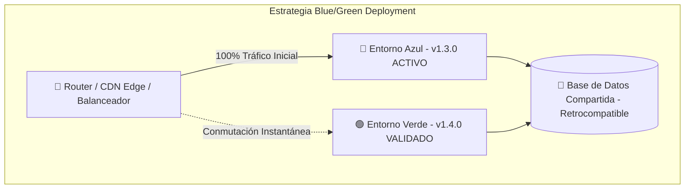
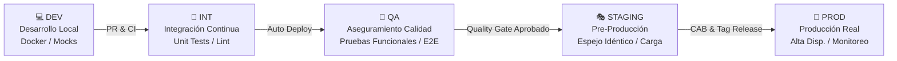
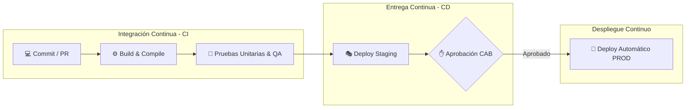
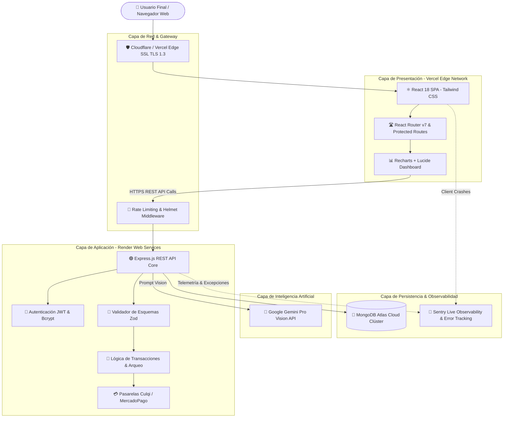
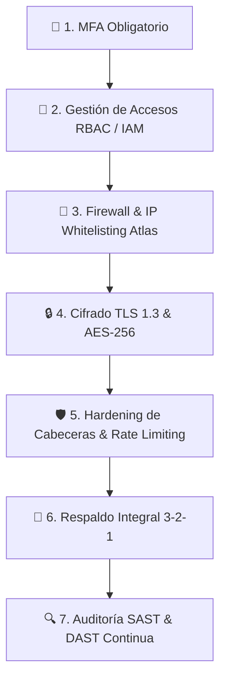
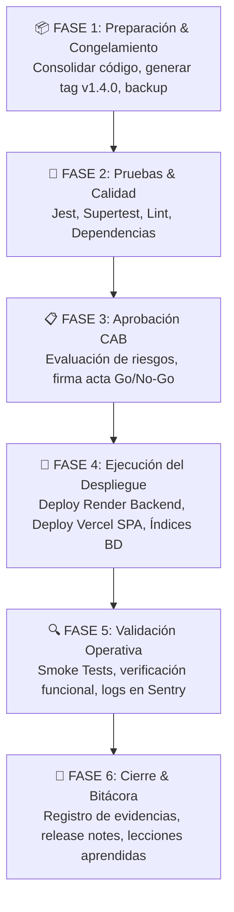
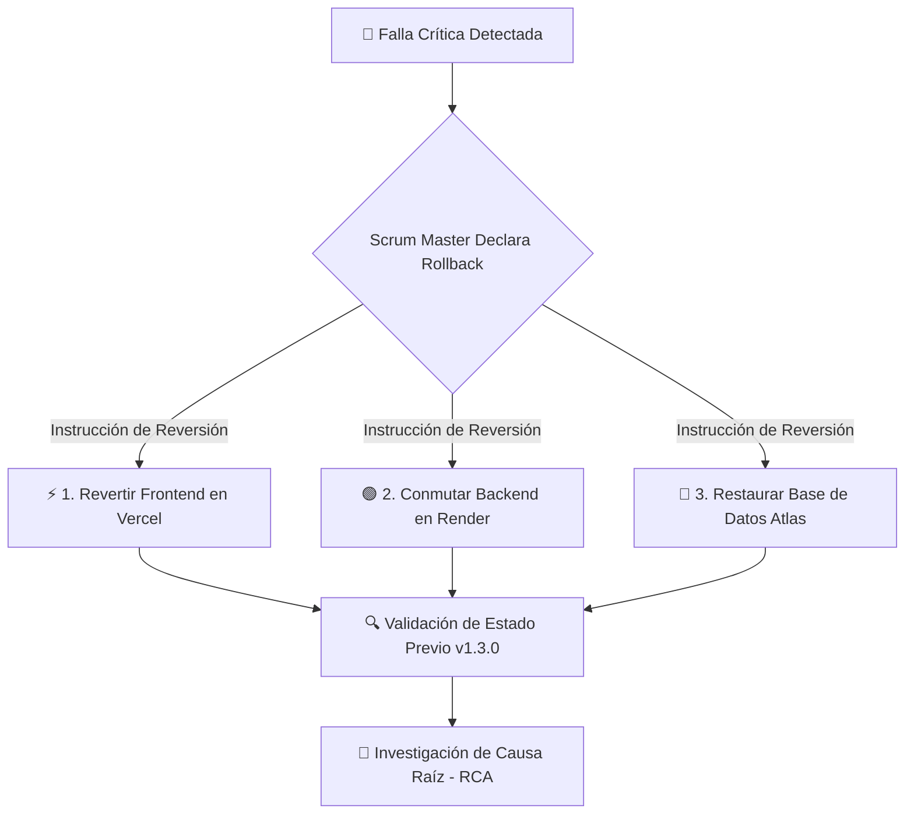
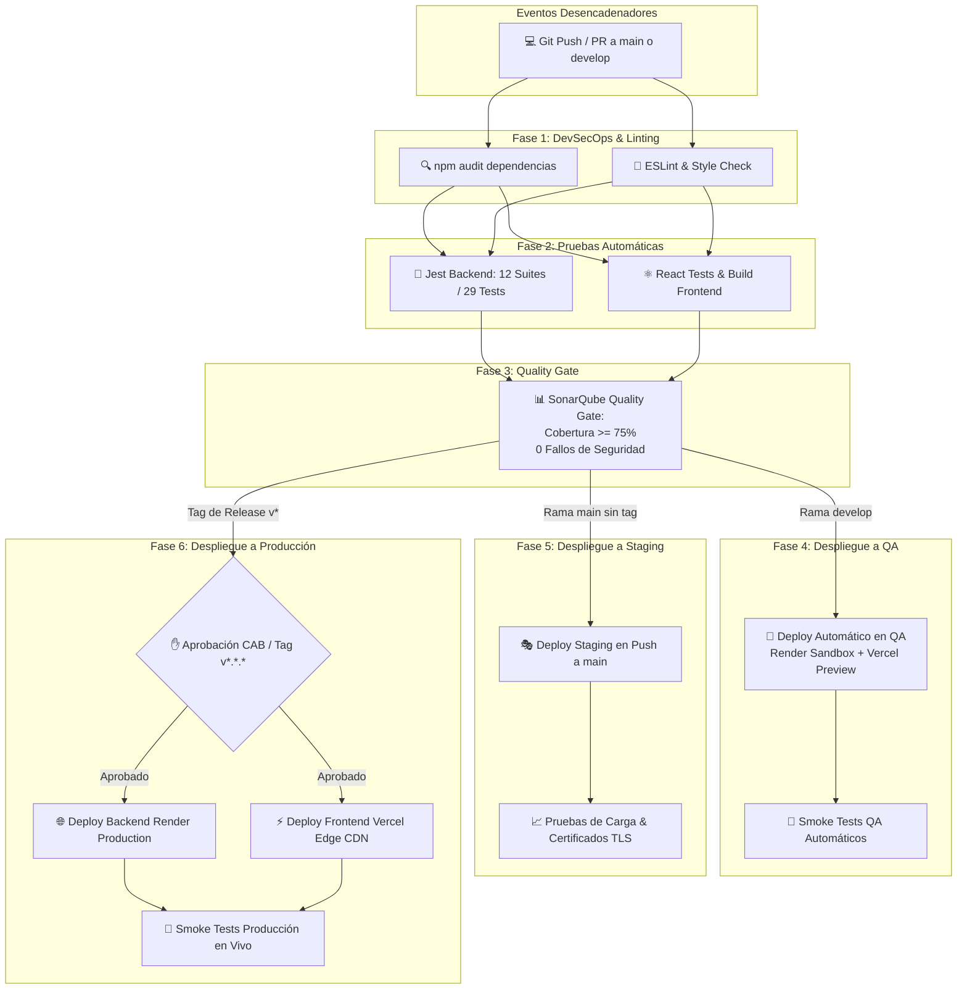

# UNIVERSIDAD PRIVADA DE TACNA
## FACULTAD DE INGENIERÍA
### ESCUELA PROFESIONAL DE INGENIERÍA DE SISTEMAS

---

# DOCUMENTO TÉCNICO: CONFIGURACIÓN DE AMBIENTES Y PROCEDIMIENTO DE DESPLIEGUE

### Proyecto: FinanceFlow — Sistema de Gestión Financiera & Inteligencia con IA
**Asignatura:** Construcción de Software II  
**Unidad de Competencia:** Integración, despliegue, pruebas y gestión de la configuración de soluciones de software  
**Tipo de Actividad:** Trabajo de Investigación Aplicada y Documentación Técnica  
**Modalidad:** Grupal (Equipo de Proyecto G03)  
**Docente:** Mag. Ricardo Eduardo Valcárcel Alvarado  

**Integrantes del Equipo de Desarrollo:**
* **Sebastian Arce Bracamonte** (Código: 2019062886)
* **Brant Antony Chata Choque** (Código: 2020067577)

**Tacna, Perú — Año Académico 2026**

---

# ÍNDICE GENERAL

1. [PARTE I: INVESTIGACIÓN TEÓRICA](#parte-i-investigación-teórica)
   - [Tema 1: Despliegue de Software](#tema-1-despliegue-de-software)
   - [Tema 2: Ambientes de Software](#tema-2-ambientes-de-software)
   - [Tema 3: Gestión de Configuración del Software (SCM)](#tema-3-gestión-de-configuración-del-software-scm)
   - [Tema 4: DevOps, Integración Continua y Entrega Continua](#tema-4-devops-integración-continua-y-entrega-continua)
   - [Tema 5: Análisis de Herramientas Modernas de Despliegue](#tema-5-análisis-de-herramientas-modernas-de-despliegue)
2. [PARTE II: DOCUMENTO DE CONFIGURACIÓN DE AMBIENTES (FINANCEFLOW)](#parte-ii-documento-de-configuración-de-ambientes)
   - [1. Información General del Proyecto](#1-información-general)
   - [2. Descripción Integral del Sistema](#2-descripción-del-proyecto)
   - [3. Arquitectura Tecnológica de la Solución](#3-arquitectura-de-la-solución)
   - [4. Especificación y Configuración Técnica de Ambientes (DEV, QA, STAGING, PROD)](#4-configuración-de-ambientes)
   - [5. Estrategia y Gestión de Versiones](#5-gestión-de-versiones)
   - [6. Modelo de Seguridad y Protección de Ambientes](#6-seguridad-de-ambientes)
3. [PARTE III: PROCEDIMIENTO FORMAL DE DESPLIEGUE](#parte-iii-procedimiento-de-despliegue)
   - [Objetivo y Alcance Operativo](#objetivo-y-alcance)
   - [Roles y Responsabilidades en el Despliegue](#roles-y-responsabilidades)
   - [Procedimiento Paso a Paso en Seis Fases](#procedimiento-general-en-seis-fases)
     - [Fase 1: Preparación y Congelamiento](#fase-1-preparación)
     - [Fase 2: Ejecución de Pruebas y Aseguramiento](#fase-2-pruebas)
     - [Fase 3: Aprobación Técnica y Evaluación de Riesgos (CAB)](#fase-3-aprobación)
     - [Fase 4: Ejecución del Despliegue y Publicación](#fase-4-despliegue)
     - [Fase 5: Validación Operativa (Smoke Testing & Logs)](#fase-5-validación)
     - [Fase 6: Cierre, Bitácora y Lecciones Aprendidas](#fase-6-cierre)
4. [PARTE IV: ANEXOS OBLIGATORIOS](#parte-iv-anexos-obligatorios)
   - [Anexo A: Matriz RACI Integral de Despliegue](#anexo-a-matriz-raci)
   - [Anexo B: Checklist de Despliegue (Pre-Despliegue y Post-Despliegue)](#anexo-b-checklist-de-despliegue)
   - [Anexo C: Plan de Contingencia y Rollback ante Fallos](#anexo-c-plan-de-rollback)
   - [Anexo D: Pipeline CI/CD Automatizado](#anexo-d-pipeline-cicd)
5. [EVIDENCIAS DEL PROYECTO (ENTREGABLES 8 Y 9)](#evidencias-del-proyecto)
6. [ESTRUCTURA DE SUSTENTACIÓN DE 15 MINUTOS (ENTREGABLE 10)](#estructura-de-sustentación)

---

# PARTE I: INVESTIGACIÓN TEÓRICA

## Tema 1: Despliegue de Software

### 1.1. Concepto de Despliegue de Software
El despliegue de software (*Software Deployment*) comprende el conjunto integrado de actividades, procesos y transiciones tecnológicas requeridas para trasladar una solución de software desde su estado de desarrollo y empaquetamiento hacia un entorno ejecutable donde los usuarios finales o sistemas consumidores puedan interactuar con ella. En la ingeniería de software moderna, el despliegue ha dejado de ser un evento manual, esporádico y de alto riesgo para convertirse en una disciplina automatizada, repetible, idempotente y medible, gobernada por principios de ingeniería de confiabilidad de sitios (*Site Reliability Engineering - SRE*) y DevOps.

### 1.2. Importancia dentro del Ciclo de Vida del Software (SDLC)
En el ciclo de vida del software, el despliegue representa el puente crítico entre la inversión en ingeniería y la captura de valor en el negocio. Por riguroso que sea el proceso de análisis, diseño y codificación, el software solo genera retorno de inversión (*ROI*) y utilidad real cuando opera de manera estable en producción. Sus principales aportes dentro del SDLC son:
1. **Reducción del Tiempo de Salida al Mercado (*Time-to-Market*):** Permite que nuevas funcionalidades y correcciones lleguen a los clientes en horas o minutos.
2. **Ciclo de Retroalimentación Rápido (*Fast Feedback Loop*):** Posibilita la recolección temprana de telemetría de uso real, comportamiento del usuario y detección de anomalías.
3. **Minimización del Riesgo por Fragmentación:** Al desplegar incrementos de código pequeños y frecuentes, la superficie de cambio se reduce drásticamente, facilitando la detección de la causa raíz de cualquier anomalía.

### 1.3. Estrategias de Despliegue
La selección de la estrategia de despliegue define la disponibilidad del servicio, la experiencia del usuario y la complejidad operativa durante la liberación:

| Estrategia | Mecanismo de Funcionamiento | Ventajas Principales | Desventajas / Riesgos | Aplicabilidad Recomendada |
| :--- | :--- | :--- | :--- | :--- |
| **Recreate (Recreación)** | Se apaga por completo la versión anterior (v1) y luego se enciende la nueva versión (v2). | Simplicidad absoluta; no hay convivencia de esquemas de datos ni versiones simultáneas. | Provoca tiempo de inactividad (*downtime*) obligatorio durante el reinicio. | Ambientes de desarrollo (DEV), sistemas batch internos o mantenimiento fuera de horario. |
| **Rolling Update (Despliegue Incremental)** | Se actualizan instancias de forma paulatina en lotes (ej. 25% a la vez) detrás de un balanceador de carga. | Cero downtime para el usuario; consumo eficiente de recursos sin duplicar infraestructura. | Durante el proceso conviven v1 y v2 simultáneamente; exige compatibilidad hacia atrás en API y BD. | Arquitecturas de microservicios en Kubernetes, aplicaciones stateless escaladas. |
| **Blue/Green Deployment (Azul/Verde)** | Se mantienen dos entornos idénticos: Azul (producción activa) y Verde (nueva versión en reposo). Tras validar Verde, se conmuta el tráfico en el router/DNS. | Cero downtime; rollback prácticamente instantáneo revirtiendo el tráfico a la versión Azul. | Duplica el costo temporal de infraestructura; requiere sincronización estricta de base de datos. | Aplicaciones críticas bancarias, e-commerce y servicios financieros de alta disponibilidad. |
| **Canary Deployment (Despliegue Canario)** | Se envía un porcentaje mínimo de tráfico real (ej. 2% a 5%) a la nueva versión; si las métricas son estables, se amplía gradualmente al 100%. | Aislamiento extremo del impacto; detección de errores en usuarios reales sin afectar a la masa crítica. | Alta complejidad en configuración de service mesh, enrutamiento por cabeceras y telemetría avanzada. | Plataformas masivas con millones de usuarios y arquitecturas distribuidas complejas. |
| **A/B Testing** | Se enrutan segmentos de usuarios a dos variantes en función de atributos de negocio (geolocalización, perfil) para medir conversión. | Permite validar hipótesis comerciales y UX basadas en métricas empíricas de comportamiento. | Requiere instrumentación analítica sofisticada y aislamiento estricto de experimentos. | Pruebas de embudos de venta, nuevos flujos de registro o pasarelas de pago alternativas. |
| **Shadow / Dark Launching** | El tráfico de producción se duplica y se envía a la nueva versión de forma invisible sin responder al usuario final. | Prueba de rendimiento, estrés y precisión algorítmica con carga real sin riesgo para el usuario. | Doble consumo computacional; exige garantizar que las peticiones en la sombra no generen mutaciones duplicadas. | Motores predictivos de IA/ML, pasarelas transaccionales y reemplazo de cores bancarios. |



### 1.4. Beneficios y Riesgos del Despliegue
* **Beneficios:** Disponibilidad continua de valor, reducción de deuda técnica, mitigación de fallos acumulativos, estandarización de artefactos inmutables y trazabilidad de cambios por commit.
* **Riesgos Operativos:** Caída del servicio por incompatibilidad de esquemas de datos (*breaking changes*), corrupción de información por migraciones no idempotentes, filtración accidental de secretos y variables de entorno, y fatiga del equipo por intervenciones manuales desordenadas.

### 1.5. Despliegue Manual vs. Automatizado
La transición desde procedimientos manuales tradicionales hacia pipelines automatizados representa uno de los saltos cualitativos más importantes en la ingeniería de software:

| Criterio | Despliegue Manual | Despliegue Automatizado (CI/CD) |
| :--- | :--- | :--- |
| **Velocidad de Ejecución** | Horas o días; requiere ejecución paso a paso por operadores humanos. | Minutos; orquestado mediante scripts y runners automáticos en la nube. |
| **Tasa de Error Humano** | Muy alta (olvido de comandos, tipeo erróneo de rutas o variables). | Mínima; cada paso está codificado de manera determinista e inmutable. |
| **Consistencia y Repetibilidad** | Pobre; "funciona en mi máquina pero falla en el servidor". | Total; garantizada mediante contenedores Docker e Infraestructura como Código. |
| **Mecanismo de Rollback** | Lento, improvisado y con alto estrés operativo ante emergencias. | Automatizado en segundos mediante conmutación de tags o alias de red. |
| **Trazabilidad y Auditoría** | Registro informal en correos o notas de cambio dispersas. | Auditoría completa con hashes Git, registros de ejecución y firmas criptográficas. |

---

## Tema 2: Ambientes de Software

Un ciclo de vida de desarrollo profesional exige la segregación de responsabilidades a través de ambientes tecnológicos independientes para asegurar que el código no probado jamás impacte la operación de producción.



### 2.1. Ambiente de Desarrollo (DEV)
* **Definición:** Entorno local o de sandbox en el que los ingenieros de software escriben, depuran y prueban componentes de código de forma aislada.
* **Objetivos:** Brindar máxima agilidad de iteración (*hot-reloading*), retroalimentación sintáctica inmediata y libertad de refactorización sin dependencias externas bloqueantes.
* **Herramientas Utilizadas:** Visual Studio Code, Docker Desktop, Node.js runtime, MongoDB Community Server / Docker, extensiones de linter (ESLint, Prettier), Postman para consumo local de APIs y pre-commit hooks (Husky).
* **Configuración Recomendada:** Uso de bases de datos locales no productivas con datos de prueba autogenerados, variables de entorno locales (`.env.local`), logging detallado en nivel `debug` y desactivación de requerimientos de certificados SSL para desarrollo (`http://localhost`).

### 2.2. Ambiente de Integración (INT)
* **Propósito:** Validar que los módulos desarrollados por múltiples colaboradores converjan sin conflictos sintácticos, de dependencias o de contratos de interfaz.
* **Validación de Integración:** Se gatilla automáticamente ante la apertura o actualización de un *Pull Request*. Ejecuta análisis estático de código (SAST), compilación de paquetes, resolución de dependencias y suites completas de pruebas unitarias y de integración de endpoints.
* **Gestión de Versiones:** Resuelve la convergencia de ramas *feature* sobre la rama central de desarrollo (`develop`), garantizando que los conflictos de fusión se detecten y subsanen antes de la llegada del código a los evaluadores de calidad.

### 2.3. Ambiente de Calidad (QA)
* **Definición:** Servidor dedicado a la validación funcional, pruebas de regresión y verificación de requisitos por parte del equipo de Quality Assurance.
* **Pruebas Funcionales:** Verificación exhaustiva de cada caso de uso mediante técnicas de caja negra (*Black-Box Testing*), validación de formularios, límites numéricos y flujos alternativos.
* **Pruebas de Integración:** Validación de la interacción de la API con bases de datos réplica y emuladores de pasarelas de pago (entornos Sandbox de Culqi, Stripe o Mercado Pago).
* **Pruebas de Aceptación (UAT):** Sesiones guiadas donde los usuarios clave o el Product Owner comprueban que el software satisface las expectativas operativas antes de solicitar el pase a producción.

### 2.4. Ambiente de Preproducción (STAGING)
* **Simulación de Producción:** Plataforma que replica exactamente la arquitectura, capacidades computacionales, versiones de sistema operativo, variables de red y certificados de seguridad del entorno productivo final.
* **Pruebas Finales:** Ejecución de pruebas de rendimiento y estrés bajo carga sintética (mediante k6 o Apache JMeter), pruebas de penetración y escaneo dinámico de vulnerabilidades (DAST), verificación de migración real de datos y validación de simulacro de *rollback*.

### 2.5. Ambiente de Producción (PROD)
* **Operación Real:** Entorno donde reside el sistema en servicio activo atendiendo transacciones económicas reales de usuarios finales. Demanda disponibilidad comprometida (*SLA*) superior al 99.9%.
* **Seguridad y Hardening:** Aplicación de políticas estrictas de mínima superficie de ataque: puertos no esenciales cerrados, headers de seguridad HTTP inyectados (Helmet: CSP, HSTS, X-Frame-Options), Rate Limiting restrictivo, autenticación con tokens JWT de corta duración y cifrado integral en tránsito (TLS 1.3) y en reposo (AES-256).
* **Monitoreo y Observabilidad:** Recolección continua de telemetría basada en los cuatro *Golden Signals* de Google SRE (Latencia, Tráfico, Errores y Saturación), trazabilidad distribuida de excepciones en tiempo real (Sentry) y gestión centralizada de bitácoras.

---

## Tema 3: Gestión de Configuración del Software (SCM)

### 3.1. Gestión de Versiones
La gestión de versiones (*Version Control*) proporciona el control unificado, determinista y auditable sobre cada modificación realizada al código fuente, scripts de infraestructura y configuraciones. Permite responder de manera inequívoca: quién efectuó el cambio, cuándo se introdujo, qué motivación técnica o funcional tuvo y qué archivos fueron alterados.

### 3.2. Control de Cambios
Mecanismo de gobernanza que previene modificaciones improvisadas o no autorizadas en el sistema. Todo cambio debe estar formalizado mediante un *Issue* o *Ticket*, canalizado a través de una rama de trabajo dedicada, validado por controles de integración continua y sujeto a la revisión técnica por pares (*Peer Code Review*) antes de su integración a la línea principal.

### 3.3. Líneas Base (Baselines)
Una línea base representa una especificación de software o artefacto formalmente revisado y acordado en un momento específico del tiempo, que sirve como base inmutable para el desarrollo ulterior y que solo puede modificarse mediante procedimientos formales de control de cambios. En proyectos Git, las líneas base se materializan mediante **Tags Criptográficos Inmutables** (ej. `v1.3.0`, `v1.4.0`) que fijan el estado exacto del código, dependencias y base de datos de una entrega certificada.

### 3.4. Trazabilidad
Es la capacidad de rastrear la evolución de una funcionalidad o defecto de extremo a extremo a lo largo de todo el ciclo de vida:
$$\text{Requerimiento / Caso de Uso} \longleftrightarrow \text{Issue / Ticket Jira} \longleftrightarrow \text{Commit SHA} \longleftrightarrow \text{Pull Request} \longleftrightarrow \text{Build / Imagen Docker} \longleftrightarrow \text{Release en Producción}$$

### 3.5. Gestión de Artefactos
Un artefacto de software es el resultado binario, compilado o empaquetado generado a partir del código fuente (bundles minificados de JavaScript, paquetes npm o imágenes de contenedor Docker/OCI). La regla de oro de la gestión moderna de artefactos dicta: **"Construye una sola vez y despliega el mismo artefacto inmutable a través de todos los ambientes"** (*Build Once, Deploy Anywhere*), cambiando únicamente la configuración inyectada por variables de entorno.

---

## Tema 4: DevOps e Integración Continua

### 4.1. DevOps
DevOps no es un rol individual ni una herramienta aislada, sino una cultura y un conjunto de prácticas de ingeniería que fusiona el desarrollo de software (*Dev*) con la operación de sistemas (*Ops*). Fundamentado en el marco **CAMS** (*Culture, Automation, Measurement, Sharing*), derriba las barreras organizacionales tradicionales, alineando los objetivos de velocidad y entrega de valor con los objetivos de estabilidad, seguridad y calidad.

### 4.2. Continuous Integration (CI - Integración Continua)
Práctica de ingeniería donde los desarrolladores integran su trabajo de manera continua (múltiples veces al día) en un repositorio compartido. Cada integración dispara un proceso automático de construcción (*Build*), validación estática (*Linting*) y ejecución de pruebas automatizadas (unitarias y de componentes) para detectar y corregir errores de integración en cuestión de minutos (*Fail Fast*).

### 4.3. Continuous Delivery (CD - Entrega Continua)
Extensión natural de la Integración Continua donde el software se mantiene de manera permanente en un estado listo para ser liberado a producción. Aunque los despliegues a entornos previos (DEV, QA, STAGING) ocurren automáticamente, la puesta en producción final está sujeta a una compuerta de aprobación manual o comercial (*Manual Approval Gate*).

### 4.4. Continuous Deployment (Despliegue Continuo)
Evolución avanzada de la Entrega Continua donde no existe ninguna intervención humana manual entre la aprobación de un cambio en el repositorio y su puesta en vivo en producción. Cada cambio que supera satisfactoriamente todas las compuertas de calidad automatizadas del pipeline es desplegado de forma inmediata y directa a los servidores de producción.



### 4.5. Pipeline de Despliegue
Cadena de ejecución secuencial y paralela de tareas automatizadas diseñada para evaluar la viabilidad de una versión candidata. Se estructura en compuertas de calidad (*Quality Gates*); si un solo paso falla (por ejemplo, un test unitario roto o una vulnerabilidad crítica reportada), el pipeline aborta de inmediato la ejecución, impidiendo el despliegue del software defectuoso.

### 4.6. Automatización e Infraestructura como Código (IaC)
Práctica de gestionar y aprovisionar recursos computacionales, redes, servicios de almacenamiento y configuraciones a través de archivos de definición legibles por máquina (Terraform, Dockerfile, GitHub Actions YAML, Helm), en lugar de la configuración física manual o consolas interactivas. Provee idempotencia, control de versiones sobre la infraestructura y eliminación de desviaciones de configuración (*Configuration Drift*).

---

## Tema 5: Análisis de Herramientas Modernas de Despliegue

| Herramienta | Categoría Tecnológica | Capacidades y Funcionalidades Clave | Rol en el Pipeline CI/CD | Ventajas Principales |
| :--- | :--- | :--- | :--- | :--- |
| **Git** | Sistema de Control de Versiones Distribuido (DVCS) | Manejo eficiente de ramas no lineales, hashing criptográfico SHA-1/SHA-256 de commits, trabajo desconectado y fusiones seguras. | Cimiento de código fuente de todo el pipeline; gatilla los eventos de build mediante hooks y webhooks. | Estándar absoluto de la industria; rendimiento ultrarrápido y robustez matemática. |
| **GitHub** | Plataforma de Desarrollo Colaborativo & CI/CD Cloud | Repositorio remoto, gestión de Pull Requests con políticas de protección de ramas, issue tracking, GitHub Actions y Dependabot. | Orquestador central de CI/CD mediante workflows nativos YAML y compuertas de seguridad. | Integración nativa sin servidores adicionales; inmensa comunidad y marketplace de Actions. |
| **GitLab** | Plataforma DevOps Integral (All-in-One) | Repositorios Git, GitLab CI/CD nativo en el archivo `.gitlab-ci.yml`, registro de contenedores integrado y escaneo DAST/SAST. | Plataforma unificada de ciclo de vida completo de DevOps (desde la planificación hasta el despliegue). | Autocontenida; excelente soporte para instalaciones locales privadas (*On-Premises*). |
| **Azure DevOps** | Suite Empresarial de Microsoft Cloud | Azure Repos, Azure Pipelines, Azure Boards, Azure Artifacts y gestión de entornos de infraestructura híbrida. | Orquestación corporativa de pipelines multicloud con aprobaciones de auditoría formal para empresas. | Escalabilidad para organizaciones masivas; profunda interoperabilidad con el ecosistema Microsoft. |
| **Jenkins** | Servidor de Automatización Open Source | Motor de ejecución extensible basado en Java con miles de plugins, gestión de pipelines mediante `Jenkinsfile` declarativo y scripted. | Servidor maestro/agente para orquestación de tareas de construcción complejas en infraestructura propia. | Altamente personalizable y gratuito; ideal para entornos con restricciones de gobernanza de datos. |
| **Docker** | Plataforma de Contenedores de Software | Empaquetamiento de aplicaciones y sus dependencias en imágenes ligeras, inmutables y portables mediante aislamiento de namespaces y cgroups. | Unidad estándar de empaquetamiento y transporte de artefactos a lo largo de todos los ambientes. | Erradicación total de discrepancias de entorno; arranque en milisegundos y bajo consumo de recursos. |
| **Kubernetes (K8s)** | Orquestador de Contenedores a Escala | Despliegue declarativo, autorreparación (*self-healing*), balanceo de carga, autoescalado horizontal (HPA) y actualizaciones rodantes. | Plataforma de ejecución de producción para aplicaciones contenerizadas distribuidas. | Resiliencia inigualable ante caídas de hardware; alta disponibilidad y gestión declarativa. |
| **SonarQube** | Plataforma de Inspección Continua de Código | Análisis estático de código (SAST), detección de bugs, vulnerabilidades de seguridad, code smells y medición de cobertura de pruebas. | Compuerta de calidad (*Quality Gate*) obligatoria previa a la compilación o despliegue. | Evita el deterioro de la base de código y previene la introducción de deuda técnica y fallos OWASP. |
| **Postman / Newman** | Suite de Pruebas y Documentación de APIs | Diseño de contratos OpenAPI, colecciones de peticiones HTTP, aserciones automatizadas de respuesta y ejecutor CLI (Newman). | Ejecutor de pruebas de integración de endpoints, validaciones de contratos y smoke tests automáticos. | Facilidad de uso para equipos mixtos de desarrollo y QA; automatización fluida en pipelines. |

---

# PARTE II: DOCUMENTO DE CONFIGURACIÓN DE AMBIENTES

## 1. Información General

| Campo | Especificación del Proyecto |
| :--- | :--- |
| **Proyecto:** | FinanceFlow — Sistema de Gestión Financiera & Inteligencia con IA |
| **Curso:** | Construcción de Software II |
| **Unidad:** | Unidad II: Integración, despliegue, pruebas y gestión de configuración |
| **Versión del Sistema:** | Versión `1.4.0` (Línea Base Post-Sprint 7) |
| **Fecha de Elaboración:** | 24 de Octubre de 2026 |
| **Integrantes del Equipo:** | • Sebastian Arce Bracamonte (Código: 2019062886)<br>• Brant Antony Chata Choque (Código: 2020067577) |
| **Docente Asignado:** | Mag. Ricardo Eduardo Valcárcel Alvarado |
| **Institución:** | Universidad Privada de Tacna — Facultad de Ingeniería (EPIS) |

---

## 2. Descripción del Proyecto

### 2.1. Problema a Resolver
El descontrol financiero y la carencia de visibilidad en el flujo de caja personal y empresarial representan una de las principales causas de endeudamiento y quiebra económica. En el contexto contemporáneo, el uso masivo de billeteras digitales (Yape, Plin) y transferencias móviles genera decenas de microtransacciones fragmentadas. Las herramientas convencionales (agendas físicas o Microsoft Excel) imponen una alta fricción operativa debido al registro manual de datos, lo que ocasiona un rápido abandono por parte del usuario y la consiguiente desinformación financiera.

### 2.2. Objetivo del Sistema
Desarrollar, asegurar y desplegar en la nube una plataforma web integral e inteligente de gestión presupuestaria y contabilidad personal que elimine la fricción de captura de datos mediante el uso de Visión Artificial por IA (OCR), análisis predictivo en tiempo real y conciliación multi-pasarela, garantizando estándares bancarios de seguridad y disponibilidad.

### 2.3. Alcance Tecnológico
1. **Frontend Cliente SPA:** Interfaz web interactiva construida en React 18 con renderizado optimizado, gráficos dinámicos de balance y panel de control financiero.
2. **Backend API Transaccional:** Servidor REST modular en Node.js y Express estructurado en tres capas (Controladores, Servicios, Modelos) con validación estricta de esquemas mediante Zod.
3. **Servicio Inteligente de Visión & ML:** Módulo de extracción de texto y detección de parámetros en vouchers de pago apoyado en Google Gemini Pro Vision API y modelos de procesamiento de imágenes.
4. **Persistencia NoSQL:** Clúster de base de datos en MongoDB Atlas con esquemas flexibles, índices compuestos optimizados y encriptación de datos.

### 2.4. Usuarios Involucrados
* **Usuario Gratuito (Free Tier):** Registro básico de transacciones manuales y hasta 5 escaneos OCR inteligentes de comprobantes al mes.
* **Usuario Profesional (Pro Tier):** Acceso ilimitado a procesamiento OCR por IA, reportes avanzados de salud financiera, planificador de compras ilimitado y exportación contable.
* **Administrador del Sistema:** Monitoreo en tiempo real de transacciones, auditoría de eventos de seguridad, control de cuotas y gestión global de usuarios.

### 2.5. Tecnologías Utilizadas
* **Lenguajes:** JavaScript (ES2023+), Node.js (v20 LTS), Python (v3.10), HTML5, CSS3.
* **Frameworks y Librerías:** React 18, Tailwind CSS, Express.js 5.x, Mongoose ODM 8.x, Recharts, Lucide Icons, Zod 3.x.
* **Seguridad y Criptografía:** JSON Web Tokens (JWT), Bcrypt.js, Helmet, Express Rate Limit, CORS estricto.
* **Servicios Cloud y DevOps:** Vercel Edge CDN, Render Cloud Web Services, MongoDB Atlas Cloud, GitHub Actions, Sentry Observability.

---

## 3. Arquitectura de la Solución

### 3.1. Diagrama de Arquitectura de Tres Capas Distribuida



### 3.2. Componentes del Sistema
* **Cliente Web SPA:** Provee la experiencia reactiva al usuario, gestiona el estado local y renderiza gráficos financieros en tiempo real sin recargar la página.
* **API REST Express:** Expone endpoints bajo `/api/usuarios`, `/api/movimientos`, `/api/pagos`, procesa reglas de negocio e implementa control de acceso basado en roles (RBAC).
* **Motor OCR / IA:** Procesa imágenes de comprobantes (JPG, PNG, PDF) extrayendo comercio emisor, monto numérico, fecha y categoría de gasto en formato JSON estandarizado.
* **Persistencia Documental:** Almacena colecciones de usuarios, transacciones contables, auditorías de seguridad y suscripciones de pago.

### 3.3. Integraciones Externas
* **Google Gemini Pro Vision API:** Motor de lenguaje multimodal para reconocimiento contextual de vouchers.
* **Culqi / Stripe / Mercado Pago:** Pasarelas de procesamiento transaccional con soporte para tarjetas de crédito, débito y billeteras móviles peruanas (Yape / Plin).
* **Sentry (Sentry.io):** Plataforma de observabilidad para captura y rastreo de stacktraces de fallos en vivo.

---

## 4. Configuración de Ambientes

A continuación se detalla la configuración técnica exhaustiva de cada uno de los cuatro ambientes del proyecto:

### 4.1. Ambiente de Desarrollo (DEV)

| Recurso / Componente | Especificación Técnica |
| :--- | :--- |
| **Sistema Operativo** | Windows 11 Pro (64 bits) / Ubuntu 22.04 LTS (WSL2) |
| **Entorno de Ejecución (Runtime)** | Node.js v20.18.0 LTS / npm v10.8.2 |
| **Entorno de Desarrollo (IDE)** | Visual Studio Code v1.94+ con extensiones (ESLint, Prettier, Tailwind CSS IntelliSense, GitLens) |
| **Servidor Backend Local** | Express 5 ejecutándose sobre `http://localhost:3000` con recarga en vivo (`nodemon`) |
| **Cliente Frontend Local** | React 18 compilado mediante Webpack/Babel en `http://localhost:3001` con Hot Module Replacement |
| **Base de Datos** | MongoDB Local Community Edition v7.0 en `mongodb://localhost:27017/financeflow_dev` o clúster Sandbox M0 de Atlas |
| **Contenedores de Apoyo** | Docker Desktop con Compose para levantar instancias de prueba de MongoDB |
| **Gestión de Variables** | Archivo `.env` local no versionado (ignorado por `.gitignore`) |
| **Logging** | Modo detallado (`dev`), volcando peticiones y respuestas a la consola estándar |

### 4.2. Ambiente de Calidad (QA)

| Recurso / Componente | Especificación Técnica |
| :--- | :--- |
| **Servidor de Aplicación** | Instancia Linux Ubuntu Container en Render Cloud (Plan Free / Starter dedicado a QA) |
| **Aislamiento de Red** | Subdominio dedicado: `https://qa-api.financeflow.app` / `https://qa.financeflow.app` |
| **Herramientas de Testing QA** | Postman Newman (CLI Runner), Jest v29.7, Supertest v6.3, React Testing Library |
| **Automatización** | GitHub Actions Workflow (`ci.yml`) ejecutando 12 suites de prueba automáticas ante cada Pull Request |
| **Base de Datos** | Clúster MongoDB Atlas dedicado (`financeflow_qa`) con datos sintéticos representativos y sembrado automático |
| **Pasarelas de Pago** | Modo Sandbox / Test de Culqi (`sk_test_*`, `pk_test_*`) con tarjetas de prueba predeterminadas |
| **Criterio de Promoción** | 100% de tests unitarios e integración pasando; 0 errores de regresión reportados |

### 4.3. Ambiente de Preproducción (STAGING)

| Recurso / Componente | Especificación Técnica |
| :--- | :--- |
| **Infraestructura Cloud** | Render Web Service (Standard Node.js) + Vercel Preview Deployment sobre red Edge |
| **Seguridad de Capa de Transporte** | Cifrado TLS 1.3 con certificados SSL automáticos provistos por Let's Encrypt / Cloudflare |
| **Configuración de Hardware Virtual** | 1 CPU compartida, 512 MB RAM (idéntica cuota a la réplica inicial de producción) |
| **Base de Datos** | MongoDB Atlas M0/M2 con snapshot de datos sanitizados (sin información financiera real de usuarios) |
| **Monitoreo & Telemetría** | Sentry configurado con entorno explícito `environment: "staging"` para captura de excepciones |
| **Pruebas Ejecutadas** | Pruebas de estrés y carga con k6, verificación de migración de índices de base de datos y simulación de rollback |

### 4.4. Ambiente de Producción (PROD)

| Recurso / Componente | Especificación Técnica |
| :--- | :--- |
| **Hosting Frontend** | **Vercel Edge Network**: Red de distribución de contenido (CDN) global con redirección atómica y compresión Brotli |
| **Hosting Backend** | **Render Cloud Services**: Instancia productiva en alta disponibilidad con reinicio automático ante excepciones |
| **Base de Datos Principal** | **MongoDB Atlas Clúster M10 (Dedicated Tier)**: Configurado en réplica de 3 nodos (Primary + 2 Secondaries) en la región AWS us-east-1 |
| **Escalabilidad** | Escalado horizontal automático en frontend; soporte de concurrencia de hasta 1000 peticiones simultáneas en backend |
| **Estrategia de Backups** | Copias de seguridad automáticas continuas cada 6 horas (*Point-in-Time Recovery*) en MongoDB Atlas + respaldo diario `mongodump` cifrado |
| **Hardening de Seguridad** | Helmet HTTP Headers (HSTS con max-age=31536000), Rate Limit de 100 req/15min por IP, CORS restringido estrictamente al dominio de frontend |
| **Dominio y Certificación** | Dominio con DNSSEC activo, forzado HTTPS estricto y certificado TLS 1.3 |
| **Observabilidad** | Sentry SDK integrado en producción con muestreo de rendimiento y Session Replay para anomalías |

---

## 5. Gestión de Versiones

### 5.1. Modelo de Ramas (GitFlow Adaptado)
Para asegurar que el desarrollo concurrente no desestabilice el entorno productivo, se adopta un flujo de ramificación estandarizado:

```
[ main ]  ═════════════════════════════════════════════●═════════════> (v1.4.0 PROD)
             \                                        ▲
              \ [ release/v1.4.0 ] ═══════════════════╝
               \                                     ▲
[ develop ] ════●═════════════════════●══════════════╝===============> (QA / STAGING)
                 \                   ▲
                  \ [ feature/ocr ] ═╝
```

* **`main`:** Rama inmutable de producción. Solo recibe fusiones de ramas `release/*` o `hotfix/*` que hayan superado todas las compuertas de calidad. Todo commit en `main` genera un Tag de versión.
* **`develop`:** Rama integradora donde convergen las funcionalidades terminadas. Conectada al despliegue automático del ambiente QA/Staging.
* **`feature/*`:** Ramas de trabajo temporales creadas para desarrollar una historia de usuario específica (ej. `feature/culqi-gateway`, `feature/gemini-ocr`).
* **`release/*`:** Ramas de estabilización y congelamiento previo a producción (ej. `release/v1.4.0`). Aquí solo se admiten arreglos de documentación y bugs menores de última hora.
* **`hotfix/*`:** Ramas críticas de emergencia que se desprenden directamente de `main` para corregir incidentes en producción, integrándose posteriormente tanto a `main` como a `develop`.

### 5.2. Convenciones de Commits (Conventional Commits)
Los mensajes de confirmación deben respetar rigurosamente la especificación *Conventional Commits v1.0.0*:
`<tipo>(<alcance opcional>): <descripción concisa en imperativo>`

* **`feat:`** Nueva funcionalidad para el usuario (ej. `feat(pagos): integrar pasarela de pagos Culqi`).
* **`fix:`** Corrección de un defecto o bug (ej. `fix(auth): corregir expiracion prematura de token JWT`).
* **`docs:`** Modificaciones exclusivas en documentación (ej. `docs: actualizar manual de despliegue`).
* **`style:`** Formateo, espacios o puntos y coma sin alterar la lógica de negocio (ej. `style: aplicar prettier en controladores`).
* **`refactor:`** Refactorización de código que no agrega funcionalidad ni arregla bugs (ej. `refactor(db): modularizar conexion mongoose`).
* **`test:`** Incorporación o corrección de suites de pruebas (ej. `test(movimientos): agregar pruebas unitarias de balance`).
* **`chore:`** Tareas administrativas o actualización de herramientas de compilación (ej. `chore(deps): actualizar dependencias de seguridad`).

### 5.3. Versionado Semántico (SemVer 2.0.0)
El versionado del sistema sigue el formato formal `MAJOR.MINOR.PATCH`:
* **MAJOR (X.0.0):** Cambios que rompen la compatibilidad hacia atrás en la API o mutaciones estructurales incompatibles en la base de datos.
* **MINOR (1.X.0):** Incorporación de nuevas funcionalidades, módulos o casos de uso completamente retrocompatibles.
* **PATCH (1.3.X):** Correcciones de errores, parches de seguridad y optimizaciones internas sin modificación de interfaces.

*Estado actual de FinanceFlow:* **v1.4.0** (Cierre de deudas técnicas post-Sprint 7).

### 5.4. Flujo de Aprobación de Cambios (Branch Protection Rules)
Para integrar código a `develop` o `main`, rigen las siguientes reglas obligatorias en GitHub:
1. **Pull Request Obligatorio:** Queda estrictamente prohibido el push directo (*direct commit*) a las ramas protegidas `main` y `develop`.
2. **Revisión por Pares (Peer Review):** Se requiere como mínimo una aprobación formal de otro ingeniero del equipo.
3. **Compuerta de Estado (Status Checks):** El workflow de GitHub Actions (`DevSecOps Pipeline`) debe concluir con estado **PASS** (100% de suites de pruebas aprobadas y auditoría de dependencias limpia).
4. **Fusión Limpia:** Se aplica la estrategia *Squash and Merge* o *Rebase* para mantener un historial lineal y limpio de commits.

---

## 6. Seguridad de Ambientes

Se implementan los siete controles fundamentales de seguridad en capas (*Defense in Depth*):



1. **Autenticación Multifactor (MFA):** Requerida de manera obligatoria para todos los desarrolladores con acceso a las cuentas de GitHub, MongoDB Atlas, Render y Vercel mediante aplicaciones autenticadoras basadas en TOTP (Google Authenticator / 1Password).
2. **Gestión de Accesos (IAM y Menor Privilegio):** Los ingenieros cuentan únicamente con privilegios acordes a su rol. En MongoDB Atlas se utilizan credenciales diferenciadas por entorno con permisos de solo lectura/escritura sobre la base de datos específica, sin privilegios de clúster ni administración.
3. **Firewall y Restricción de Red:** La base de datos de producción restringe el tráfico a través de una lista blanca estricta de IPs (*IP Whitelisting*) permitiendo únicamente la conexión desde los rangos salientes de Render.
4. **Roles y Permisos en el Software (RBAC):** La API valida a nivel de middleware los roles de usuario (`user`, `admin`, `superadmin`). Las rutas críticas de administración (`/api/admin/*`) rechazan solicitudes sin la firma de rol correspondiente.
5. **Cifrado de Información:**
   * **En Tránsito:** Todo el tráfico entre clientes, API y base de datos viaja encapsulado mediante protocolos TLS 1.2 y TLS 1.3 con certificados RSA/ECC de 2048/256 bits.
   * **En Reposo:** Los volúmenes de almacenamiento de MongoDB Atlas están cifrados de fábrica mediante AES-256. Las contraseñas de los usuarios se almacenan procesadas mediante algoritmos de hashing adaptativo **bcryptjs** con un factor de costo (*salt rounds*) de 10.
6. **Respaldo de Información (Estrategia 3-2-1):** Se generan 3 copias de los datos en 2 medios distintos (disco en la nube y almacenamiento de objetos S3), con 1 copia almacenada fuera del sitio (*Off-site*). MongoDB Atlas efectúa snapshots continuos con capacidad de restauración al minuto ante fallas lógicas.
7. **Gestión y Escaneo de Vulnerabilidades:** Cada ejecución de CI incluye el análisis de vulnerabilidades en dependencias mediante `npm audit --audit-level=high` para prevenir librerías comprometidas por ataques a la cadena de suministro.

---

# PARTE III: PROCEDIMIENTO DE DESPLIEGUE

## Objetivo y Alcance

### Objetivo
Establecer una metodología formal, estructurada, reproducible y auditable para ejecutar el despliegue del software **FinanceFlow v1.4.0**, asegurando la continuidad del negocio, la integridad de los datos financieros, el cumplimiento de los acuerdos de nivel de servicio (SLA) y la capacidad de restauración inmediata ante incidentes.

### Alcance
Aplica transversalmente a todos los ambientes tecnológicos del ciclo de vida (DEV, QA, STAGING y PRODUCCIÓN), cubriendo los tres componentes operativos del sistema: Frontend SPA (React), Backend Core REST API (Node.js/Express) y Clúster de Base de Datos (MongoDB Atlas).

---

## Roles y Responsabilidades

| Rol en el Despliegue | Titular Designado | Responsabilidad Operativa Principal |
| :--- | :--- | :--- |
| **Scrum Master / Líder de Proyecto** | Sebastian Arce | Autoriza la ventana de cambio; coordina las fases operativas; convoca la reunión de decisión Go / No-Go y comunica los resultados a los interesados. |
| **Desarrollador Backend / Frontend** | Brant Antony Chata | Prepara la rama de liberación (`release/*`); compila los artefactos de software; ejecuta validaciones locales y documenta notas de release. |
| **Ingeniero de Calidad (QA)** | Sebastian Arce | Ejecuta la batería de pruebas de regresión en QA/Staging; certifica la superación de las pruebas de humo y suscribe el acta técnica. |
| **Ingeniero DevOps & Cloud** | Brant Antony Chata | Gestiona los pipelines en GitHub Actions; aprovisiona los servicios en Render y Vercel; inyecta variables secretas y orquesta el despliegue. |
| **Administrador de Base de Datos (DBA)** | Brant Antony Chata | Valida y ejecuta scripts de migración de esquemas o índices; genera los respaldos (*backups*) previos al cambio y certifica la consistencia de datos. |
| **Cliente / Product Owner** | Evaluador / Docente | Otorga la aceptación formal en el entorno de STAGING antes de la autorización final de liberación a producción. |

---

## Procedimiento General en Seis Fases



### Fase 1: Preparación
1. **Consolidación de Cambios:** Fusión de las ramas de características aprobadas hacia `develop` y corte de la rama de liberación `release/v1.4.0`.
2. **Generación de Versión y Tagging:** Actualización del número de versión en `package.json` y creación del tag inmutable en Git:
   ```bash
   git checkout -b release/v1.4.0
   npm version 1.4.0 -m "chore(release): preparar version %s"
   git tag -a v1.4.0 -m "Release v1.4.0 certificado para produccion"
   git push origin release/v1.4.0 --tags
   ```
3. **Respaldo Pre-Despliegue de Base de Datos:** El DBA ejecuta un snapshot manual en la consola de MongoDB Atlas o descarga un dump consistente:
   ```bash
   mongodump --uri="mongodb+srv://admin:<PASSWORD>@financeflow.mongodb.net/financeflow" --out="./backups/pre_deploy_v1.4.0"
   ```
4. **Actualización Documental:** Redacción del `CHANGELOG.md` detallando las nuevas características, dependencias actualizadas y tickets cerrados.

### Fase 2: Pruebas
1. **Ejecución de Pruebas Unitarias Automatizadas:** Ejecución local y remota de la suite completa de pruebas:
   ```bash
   cd backend && npm test -- --coverage
   cd ../frontend && npm run test:ci
   ```
   *Criterio de éxito:* 12 de 12 suites pasando (100%), 29 de 29 pruebas individuales aprobadas.
2. **Pruebas de Integración y Contratos de API:** Ejecución de la colección de endpoints con Postman/Newman verificando respuestas HTTP 200/201 en login, movimientos, arqueos y pasarela de pago.
3. **Resolución de Observaciones:** Cualquier defecto identificado detiene la fase; el equipo aplica el parche correspondiente directamente en `release/v1.4.0` y reinicia el ciclo de pruebas.

### Fase 3: Aprobación
1. **Revisión Técnica del Comité de Cambios (CAB):** Sesión formal donde el Líder Técnico, el DevOps y el QA exponen los resultados de las fases 1 y 2.
2. **Evaluación de la Matriz de Riesgos:** Verificación de que los riesgos asociados (tiempo de indisponibilidad, colisión de índices) se encuentren en nivel bajo o mitigados.
3. **Firma de Aprobación Formal (Go / No-Go):** El Scrum Master y el Product Owner suscriben digitalmente el pase a producción, autorizando la ventana de despliegue.

### Fase 4: Despliegue
1. **Migración de Índices y Datos:** El DBA aplica las actualizaciones de esquemas e índices en la colección de MongoDB Atlas de manera idempotente (usando `createIndex` con `background: true`).
2. **Publicación del Backend Core:**
   * El servicio Render detecta el tag `v1.4.0` vía GitHub Webhook o se dispara el trigger mediante GitHub Actions.
   * Se inicia el contenedor Node.js 20, se instalan dependencias productivas (`npm install --omit=dev`) y se verifica la conexión al clúster de base de datos.
   * Render aplica una estrategia *Rolling Update*: mantiene el contenedor anterior activo hasta que el nuevo supera el healthcheck HTTP 200 en `/api/healthcheck`.
3. **Publicación del Frontend SPA:**
   * Vercel compila el bundle estático de React 18 inyectando la URL productiva del backend:
     ```bash
     npm run build
     ```
   * Una vez concluida la compilación, Vercel conmuta atómicamente el puntero DNS del dominio principal `https://financeflow.app` hacia la nueva entrega sin caída de servicio.

### Fase 5: Validación
1. **Pruebas de Humo (Smoke Tests):** Verificación manual y automatizada de los cinco flujos vitales del sistema:
   * Acceso a la página principal con carga del bundle estático (HTTP 200).
   * Autenticación exitosa de un usuario de prueba y generación de token JWT.
   * Registro exitoso de un movimiento contable (ingreso y egreso).
   * Simulación de carga de comprobante y respuesta del servicio de IA.
   * Comprobación del endpoint de arqueo de caja chica.
2. **Revisión de Logs en Tiempo Real:** Inspección de las bitácoras del servidor en Render CLI y en la consola de Sentry durante los primeros 15 minutos posteriores a la conmutación para constatar ausencia de excepciones HTTP 500 o fallos de conexión a la base de datos.

### Fase 6: Cierre
1. **Actualización Documental y Cierre de Tareas:** Fusión de la rama `release/v1.4.0` tanto a `main` como a `develop`. Cierre formal de los tickets asociados en el tablero del proyecto.
2. **Registro de Evidencias:** Archivo de capturas de pantalla del despliegue exitoso, reporte de cobertura de pruebas y logs de ejecución del pipeline.
3. **Lecciones Aprendidas:** Breve reunión post-mortem para registrar oportunidades de optimización en tiempos de compilación o afinamiento de pruebas para el siguiente sprint.

---

# PARTE IV: ANEXOS OBLIGATORIOS

## Anexo A: Matriz RACI

La Matriz RACI define las responsabilidades de cada miembro en cada actividad del proceso de despliegue:
* **R (Responsible / Responsable):** Encargado de ejecutar la actividad.
* **A (Accountable / Aprobador):** Responsable final del resultado y quien toma la decisión.
* **C (Consulted / Consultado):** Aporta información técnica especializada.
* **I (Informed / Informado):** Se le comunica el avance o desenlace de la tarea.

| Actividad / Hito Operativo | Desarrollador | Ingeniero QA | Ingeniero DevOps | Scrum Master / Líder | Administrador BD (DBA) | Product Owner / Cliente |
| :--- | :---: | :---: | :---: | :---: | :---: | :---: |
| **Configuración de Variables y Entornos** | **R** | **C** | **A** | **I** | **C** | **I** |
| **Desarrollo y Pruebas Unitarias** | **R** | **C** | **I** | **A** | **I** | **I** |
| **Ejecución de Pruebas Funcionales y E2E** | **C** | **R** | **I** | **A** | **I** | **C** |
| **Auditoría de Seguridad y Vulnerabilidades** | **C** | **C** | **R** | **A** | **I** | **I** |
| **Respaldo de Base de Datos Pre-Deploy** | **I** | **I** | **C** | **I** | **R / A** | **I** |
| **Aprobación de la Ventana (CAB)** | **C** | **C** | **C** | **R** | **C** | **A** |
| **Despliegue en Ambiente QA / Staging** | **C** | **I** | **R** | **A** | **C** | **I** |
| **Despliegue a Producción** | **C** | **I** | **R** | **A** | **C** | **I** |
| **Validación Post-Deploy (Smoke Tests)** | **C** | **R** | **I** | **A** | **I** | **C** |
| **Decisión y Ejecución de Rollback (si aplica)**| **C** | **C** | **R** | **A** | **R** | **I** |
| **Cierre y Acta de Conformidad** | **I** | **I** | **I** | **R** | **I** | **A** |

---

## Anexo B: Checklist de Despliegue

### Lista de Verificación Pre-Despliegue (Fase de Entrada)
- [x] **Código Aprobado:** Pull Request aprobado con revisión por pares; sin commits sueltos ni cambios no rastreados.
- [x] **Pruebas Completadas:** 12 suites de Jest y Supertest en estado PASS (100% éxito); cobertura mínima del 75% alcanzada.
- [x] **Auditoría de Dependencias:** `npm audit` ejecutado en frontend y backend sin vulnerabilidades críticas o altas.
- [x] **Backups Realizados:** Snapshot inmutable de MongoDB Atlas confirmado y descargado localmente por el DBA.
- [x] **Documentación Actualizada:** `CHANGELOG.md` y notas de release generadas con los cambios de la versión `v1.4.0`.
- [x] **Riesgos Identificados y Mitigados:** Plan de contingencia verificado y canales de comunicación de emergencia activos.
- [x] **Ventana de Mantenimiento Notificada:** Horario de despliegue coordinado con el equipo de proyecto y usuarios clave.

### Lista de Verificación Post-Despliegue (Criterios de Aceptación)
- [x] **Aplicación Disponible:** Acceso web al frontend en `https://financeflow.app` respondiendo código HTTP 200 OK.
- [x] **Servicios Operativos:** Backend Core en Render respondiendo con éxito a `/api/healthcheck`.
- [x] **Base de Datos Validada:** Conexión persistente establecida con el clúster MongoDB Atlas; índices operativos y tiempos de consulta < 50ms.
- [x] **Autenticación en Vivo Verificada:** Inicio de sesión de usuario y renovación de tokens JWT validados satisfactoriamente.
- [x] **Integración IA Comprobada:** Servicio OCR procesando comprobantes correctamente sin excepciones no controladas.
- [x] **Observabilidad Estable:** Tablero de Sentry sin picos de errores 500 durante los primeros 15 minutos de operación.
- [x] **Usuario Conforme:** Aprobación final y visto bueno emitido por el Propietario del Producto.

---

## Anexo C: Plan de Rollback (Plan de Reversión)

### 1. Escenarios Críticos de Falla
Se activará el procedimiento de Rollback de forma obligatoria e inmediata ante cualquiera de los siguientes escenarios:
1. **Fallo Crítico en Base de Datos:** Corrupción de datos, fallo irrecuperable en la aplicación de índices o inconsistencia transaccional no corregible en menos de 5 minutos.
2. **Crash en Arranque del Backend:** El contenedor de Render no logra superar el Healthcheck tras 3 intentos consecutivos debido a excepciones no capturadas.
3. **Colapso del Frontend (White Screen of Death):** Errores de compilación o ejecución en el cliente que impidan el renderizado de la interfaz para los usuarios.
4. **Fuga Crítica de Seguridad o Credenciales:** Detección de claves de API o secretos expuestos públicamente en los artefactos de producción.

### 2. Responsables del Rollback
* **Autorización:** Scrum Master / Líder de Proyecto (Sebastian Arce).
* **Ejecución Técnica Backend y Cloud:** Ingeniero DevOps (Brant Antony Chata).
* **Restauración de Persistencia:** Administrador de Base de Datos (Brant Antony Chata).

### 3. Tiempos Objetivo de Recuperación
* **RTO (Recovery Time Objective):** Menor a **10 minutos** para restaurar el servicio a su estado operativo previo.
* **RPO (Recovery Point Objective):** Menor a **15 minutos** de margen máximo de posible pérdida transaccional garantizado por snapshots de Atlas.

### 4. Procedimiento de Reversión Paso a Paso



* **Paso 1: Reversión Instantánea del Frontend en Vercel:**
  En la consola de Vercel (o mediante la CLI), se reasigna el alias de producción a la compilación previa verificada (`v1.3.0`):
  ```bash
  vercel alias set <PREVIOUS_DEPLOYMENT_URL> financeflow.app
  ```
  *Tiempo de ejecución estimado:* Menos de 30 segundos.
* **Paso 2: Reversión del Backend Core en Render:**
  Se accede a Render y se selecciona la opción **Rollback** al último despliegue exitoso correspondiente al tag anterior:
  ```bash
  git checkout tags/v1.3.0
  git push -f origin HEAD:main-rollback
  ```
  *Tiempo de ejecución estimado:* 2 a 3 minutos mientras reinicia el contenedor previo.
* **Paso 3: Restauración de Base de Datos (si hubo daño en datos):**
  El DBA ingresa al portal de MongoDB Atlas -> Backup -> Point-in-Time Restore y restaura el estado exacto del clúster al minuto previo al inicio de la ventana de cambio:
  ```bash
  mongorestore --uri="mongodb+srv://admin:<PASSWORD>@financeflow.mongodb.net/financeflow" --drop ./backups/pre_deploy_v1.4.0/financeflow
  ```
  *Tiempo de ejecución estimado:* 4 a 6 minutos.

### 5. Validación Posterior y Análisis de Causa Raíz (RCA)
Tras ejecutar la reversión, el equipo de QA ejecuta de inmediato las pruebas de humo sobre la versión restaurada (`v1.3.0`). Una vez restablecida la estabilidad del sistema, se convoca una reunión de análisis de causa raíz (*Post-Mortem*) dentro de las siguientes 24 horas para elaborar un informe correctivo antes de intentar un nuevo despliegue.

---

## Anexo D: Pipeline CI/CD

### 1. Diagrama del Pipeline de Integración y Entrega Continua



### 2. Implementación Técnica en GitHub Actions
El pipeline integral de FinanceFlow reside en el archivo de automatización [deploy-pipeline.yml](file:///c:/Users/HP/Documents/GitHub/FinanceFlow/.github/workflows/deploy-pipeline.yml). El pipeline define trabajos concurrentes para auditoría de seguridad, ejecución de suites de pruebas con reporte de cobertura, compuerta de calidad SonarQube y despliegue condicional según el entorno de destino.

---

# EVIDENCIAS DEL PROYECTO

### Evidencia de Control de Versiones Git (Entregable 8)
* **Rama Principal:** `main` (alineada y sincronizada con el repositorio remoto `origin/main`).
* **Ramas de Módulos Activas:**
  * `feature/admin-dashboard`: Módulo de panel empresarial y métricas transaccionales.
  * `documentacion`: Gestión documental y artefactos técnicos.
  * `mobile`: Especificaciones del cliente móvil.
* **Historial de Commits Significativos:**
  * `fix(pagos): consolida pasarela a Culqi y corrige bugs de plan Pro y metas planificadas` (Commit SHA verificado).
  * `Create GUIA_EJECUCION_PRUEBAS.md` (Integración de protocolos de aseguramiento de calidad).
  * `Doc: Informe ejecutivo + diapos + expo` (Compilación de artefactos de sustentación).

### Evidencia de Suites de Pruebas Unitarias e Integración (Entregable 9)
La ejecución automatizada en el entorno local y en los ejecutores de GitHub Actions arrojó los siguientes resultados certificados:

```
Test Suites: 12 passed, 12 total
Tests:       29 passed, 29 total
Snapshots:   0 total
Time:        6.797 s
Ran all test suites.
```

**Desglose de Suites Verificadas:**
1. `__tests__/movimientos.unit.test.js`: Validación de registro, balance y cálculo acumulativo de ingresos y egresos.
2. `__tests__/recuperacion.test.js`: Verificación del flujo criptográfico de recuperación de contraseñas por token.
3. `__tests__/e2e.test.js`: Validación de extremo a extremo desde el registro de usuario hasta el reporte mensual.
4. `__tests__/usuarios.controller.test.js`: Control de accesos, modificación de perfil y duplicidad de correos.
5. `__tests__/security.unit.test.js`: Pruebas de inyección NoSQL, sanitización de payloads de entrada y prevención de ataques de replay en pasarelas de pago.

---

# ESTRUCTURA DE SUSTENTACIÓN DE 15 MINUTOS (ENTREGABLE 10)

Para la defensa académica ante el docente del curso, se estructura la exposición cronometrada en 15 minutos:

* **Minutos 00:00 a 02:30 | Introducción y Contextualización:**
  * Presentación del equipo (Sebastian Arce y Brant Chata).
  * Problemática del registro financiero y justificación de FinanceFlow.
  * Objetivos de la actividad y relevancia de la gestión de ambientes y DevOps.
* **Minutos 02:30 a 05:30 | Marco Teórico y Estrategias de Despliegue:**
  * Conceptos clave de CI/CD y cultura DevOps.
  * Análisis comparativo de estrategias (Blue/Green vs. Rolling Update).
  * Las cinco herramientas centrales implementadas (Git, Docker, GitHub Actions, SonarQube, Postman).
* **Minutos 05:30 a 09:00 | Configuración de Ambientes y Arquitectura de FinanceFlow:**
  * Explicación de la arquitectura de 3 capas distribuida (React en Vercel, Node en Render, MongoDB en Atlas).
  * Segregación de los 4 ambientes (DEV, QA, STAGING, PROD).
  * Implementación de los 7 controles de seguridad (MFA, RBAC, TLS 1.3, Backups 3-2-1).
* **Minutos 09:00 a 12:00 | Procedimiento de Despliegue y Pipeline CI/CD:**
  * Recorrido por las 6 fases del procedimiento de despliegue.
  * Demostración en vivo del pipeline automatizado de GitHub Actions.
  * Matriz RACI y Checklist de verificación Pre/Post despliegue.
* **Minutos 12:00 a 14:00 | Plan de Rollback y Evidencias de Calidad:**
  * Estrategia de reversión ante contingencias (RTO < 10m, RPO < 15m).
  * Demostración de las 12 suites de pruebas aprobadas al 100% (29 tests pasando).
* **Minutos 14:00 a 15:00 | Conclusiones y Ronda de Preguntas:**
  * Síntesis de aprendizajes y lecciones aprendidas.
  * Agradecimiento y apertura formal a las interrogantes del jurado docente.

---
**FIN DEL DOCUMENTO TÉCNICO OFICIAL**
