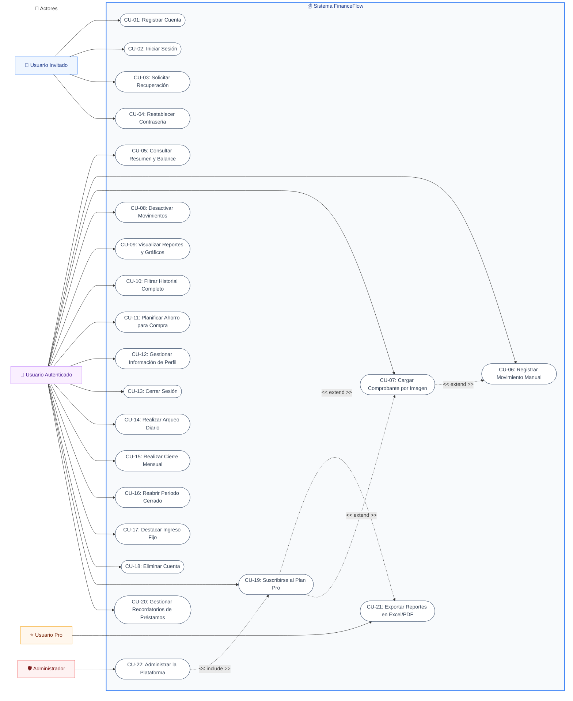

# Diagrama de Casos de Uso (Fase de Análisis) — FinanceFlow

Este documento es **autoexplicativo**: describe, en lenguaje funcional y sin tecnicismos, qué puede hacer cada tipo de usuario dentro de FinanceFlow. Refleja 1:1 las funciones realmente implementadas en el sistema (no se omite ninguna), agrupadas en 22 casos de uso.

## Actores del sistema

- **Usuario Invitado**: persona sin sesión iniciada (puede registrarse, iniciar sesión o recuperar su contraseña).
- **Usuario Autenticado**: cuenta con sesión activa (plan Free o Pro). Es el actor principal del sistema.
- **Usuario Pro**: especialización del Usuario Autenticado que pagó la suscripción; desbloquea límites ampliados.
- **Administrador**: cuenta interna con rol `admin`, gestiona la plataforma completa.

---

### Diagrama General del Sistema

---

## Descripción de cada caso de uso

| ID | Nombre | Actor | Resumen en lenguaje llano |
|---|---|---|---|
| CU-01 | Registrar Cuenta | Invitado | Crear una cuenta nueva con nombre, correo y contraseña. |
| CU-02 | Iniciar Sesión | Invitado | Ingresar con correo y contraseña para acceder a la app. |
| CU-03 | Solicitar Recuperación | Invitado | Pedir un enlace para restablecer la contraseña olvidada. |
| CU-04 | Restablecer Contraseña | Invitado | Definir una nueva contraseña usando el enlace recibido. |
| CU-05 | Consultar Resumen y Balance | Usuario | Ver en el Dashboard el total de ingresos, egresos y balance disponible. |
| CU-06 | Registrar Movimiento Manual | Usuario | Anotar a mano un ingreso o un egreso (monto, categoría, fecha). |
| CU-07 | Cargar Comprobante por Imagen | Usuario | Subir una foto de una boleta/Yape y que el sistema complete los datos solo. |
| CU-08 | Desactivar Movimientos | Usuario | Borrar (lógicamente) un movimiento que se registró por error. |
| CU-09 | Visualizar Reportes y Gráficos | Usuario | Ver gráficos de gastos por categoría y evolución mensual. |
| CU-10 | Filtrar Historial Completo | Usuario | Buscar movimientos pasados filtrando por fecha, tipo o categoría. |
| CU-11 | Planificar Ahorro para Compra | Usuario | Crear una "meta" de compra y ver en vivo cuánto le falta ahorrar. |
| CU-12 | Gestionar Información de Perfil | Usuario | Cambiar su nombre, correo o moneda preferida. |
| CU-13 | Cerrar Sesión | Usuario | Salir de la cuenta de forma segura. |
| CU-14 | Realizar Arqueo Diario | Usuario | Contar el dinero físico del día y comparar contra lo que el sistema calculó. |
| CU-15 | Realizar Cierre Mensual | Usuario | Cerrar el mes con contraseña para que esos movimientos ya no se puedan alterar. |
| CU-16 | Reabrir Periodo Cerrado | Usuario | Desbloquear un cierre anterior si se cometió un error, usando contraseña. |
| CU-17 | Destacar Ingreso Fijo | Usuario | Marcar un ingreso (ej. sueldo) para que se repita automáticamente cada mes. |
| CU-18 | Eliminar Cuenta | Usuario | Borrar la cuenta y todos sus datos de forma permanente. |
| CU-19 | Suscribirse al Plan Pro | Usuario | Pagar S/ 19.90 con tarjeta (vía Culqi) para desbloquear funciones avanzadas. |
| CU-20 | Gestionar Recordatorios de Préstamos | Usuario | Anotar dinero prestado o por cobrar, con fecha de vencimiento. |
| CU-21 | Exportar Reportes en Excel/PDF | Usuario Pro | Descargar el historial financiero en un archivo contable. |
| CU-22 | Administrar la Plataforma | Administrador | Ver métricas globales, aprobar pagos manuales y gestionar usuarios. |

## Relaciones especiales

- **CU-07 `<<extend>>` CU-06**: cargar un comprobante por imagen extiende el registro manual, ya que al final ambos crean el mismo tipo de movimiento; la imagen solo autocompleta los campos.
- **CU-19 `<<extend>>` CU-21 y CU-07**: pagar la suscripción Pro es lo que habilita (extiende) el acceso a exportar reportes y a usar el OCR sin el límite mensual gratuito.
- **CU-22 `<<include>>` CU-19**: dentro de "Administrar la Plataforma", el administrador puede aprobar manualmente una solicitud de pago (Yape/BCP), lo que equivale a otorgar el mismo resultado que CU-19.
