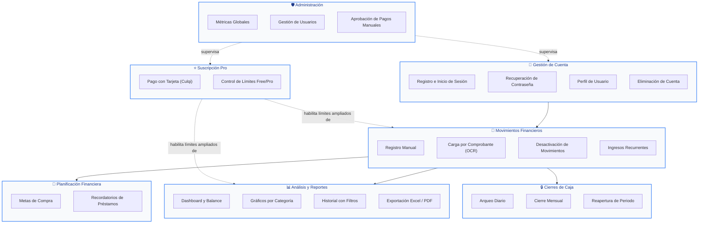

# Diagrama de Paquetes (Fase de Análisis) — FinanceFlow

Este diagrama agrupa las funciones del sistema en **módulos conceptuales de negocio** (no en carpetas de código — eso corresponde a la vista de diseño). Es autoexplicativo: cada paquete representa un área temática que cualquier persona, sin conocimientos técnicos, puede reconocer dentro de la app.

## Explicación de cada paquete

1. **Gestión de Cuenta**: todo lo relacionado a crear, acceder, recuperar y administrar la identidad del usuario.
2. **Movimientos Financieros**: el corazón de la app — registrar cada ingreso o egreso, a mano o fotografiando un comprobante.
3. **Análisis y Reportes**: convierte los movimientos crudos en información útil (balance, gráficos, historial, exportaciones contables).
4. **Planificación Financiera**: funciones que miran hacia adelante — ahorrar para una compra futura, o llevar cuenta de préstamos dados/recibidos.
5. **Cierres de Caja**: mecanismo de control diario/mensual que "congela" los movimientos pasados para evitar alteraciones.
6. **Suscripción Pro**: el módulo de monetización — procesa el pago único y decide qué límites se levantan para el usuario que paga.
7. **Administración**: panel exclusivo para el equipo de FinanceFlow, para supervisar la salud del negocio y resolver pagos manuales.

La flecha punteada indica una relación de **dependencia de habilitación** (un paquete amplía las capacidades de otro) y la flecha sólida indica **flujo de datos** (un paquete alimenta de información al siguiente).
