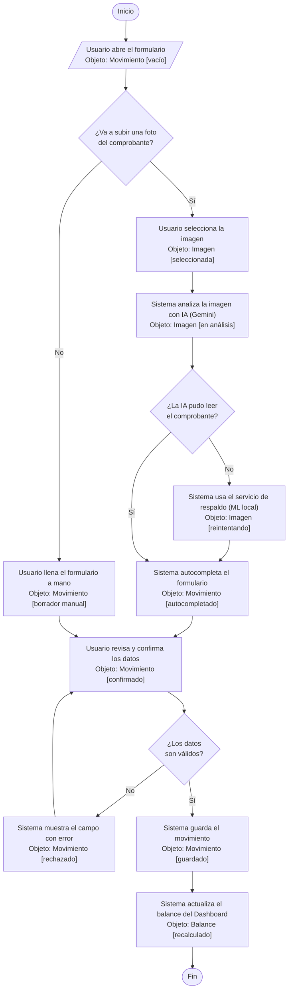
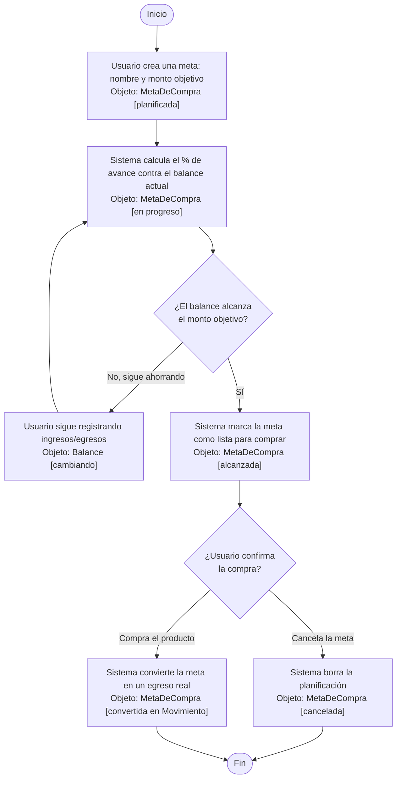
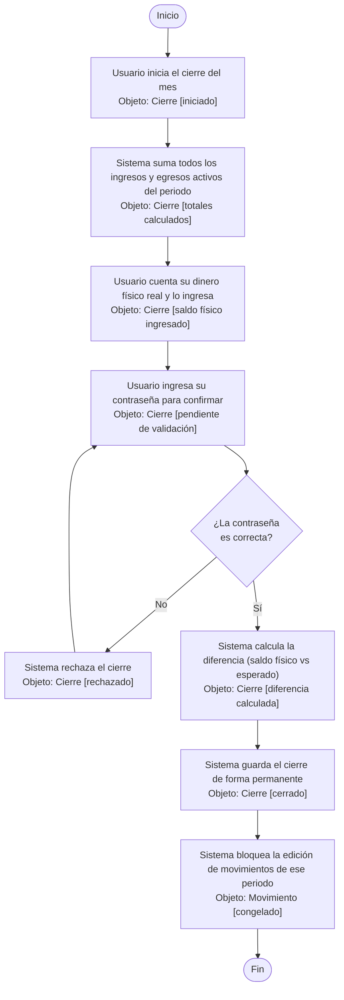

# Diagramas de Actividades con Objetos (Fase de Análisis) — FinanceFlow

Estos diagramas muestran, paso a paso y en lenguaje simple, **qué hace el usuario, qué decide el sistema, y en qué "estado" queda cada objeto de negocio** a lo largo del proceso. Cada objeto aparece entre corchetes mostrando su estado (ej. `[Movimiento: borrador]` → `[Movimiento: guardado]`).

---

## Actividad 1 — Registrar un Movimiento (manual o por foto)

---

## Actividad 2 — Planificar una Meta de Compra hasta completarla

---

## Actividad 3 — Realizar el Cierre Mensual de Caja

