# Diagramas de Secuencia (Fase de Análisis) — FinanceFlow

Un diagrama de secuencia por cada uno de los 22 casos de uso del sistema. Son conceptuales y agnósticos a la tecnología (no mencionan frameworks ni nombres de archivo — eso es la vista de diseño), usando el patrón **BCE (Borde-Control-Entidad)**:
- **Vista (Borde):** pantalla con la que interactúa el Actor.
- **Gestor (Control):** módulo que aplica las reglas de negocio.
- **Entidad:** el dato persistente del dominio.

---

### **CU-01: Registrar Cuenta**

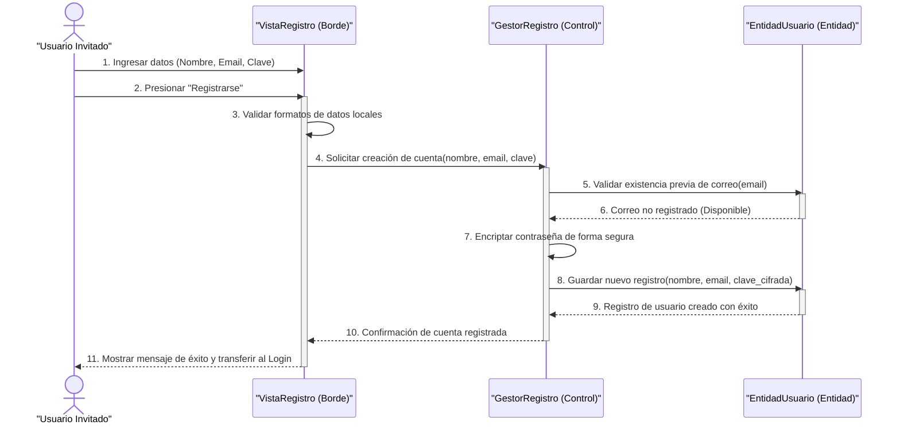

* **Excepción 1:** Datos inválidos → la Vista detiene el flujo antes del paso 4.
* **Excepción 2:** Correo ya registrado → el Gestor desiste y la Vista alerta en el campo correo.

---

### **CU-02: Iniciar Sesión**

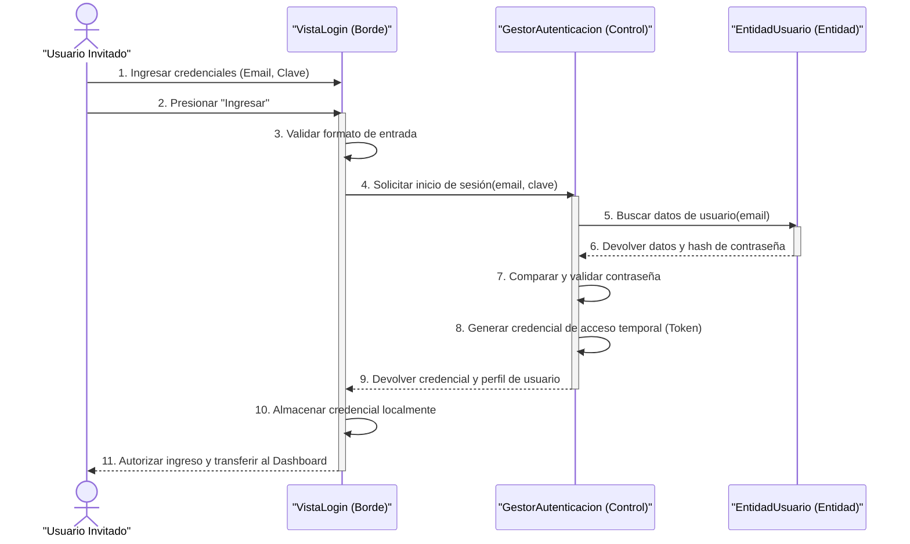

* **Excepción 1:** Formato inválido → se detiene en la Vista.
* **Excepción 2:** Credenciales incorrectas → el Gestor responde fallo genérico por seguridad.

---

### **CU-03: Solicitar Recuperación**

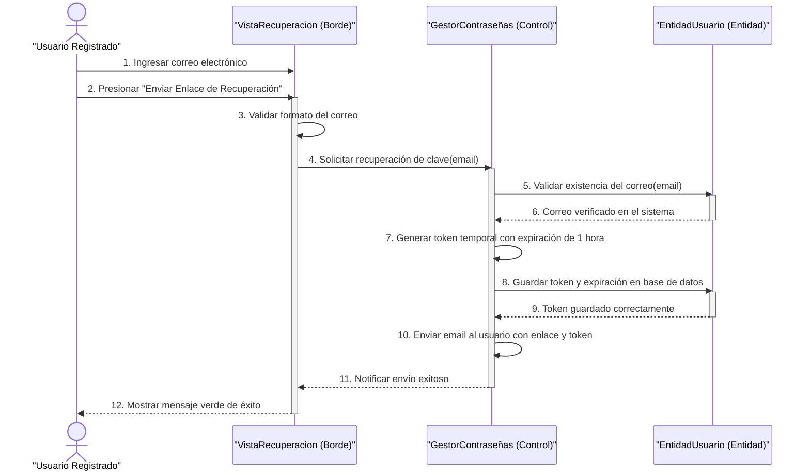

* **Excepción 1:** Formato de correo inválido → bloqueo local en la Vista.
* **Excepción 2:** Correo no registrado → el Gestor detiene el flujo sin revelar si la cuenta existe.

---

### **CU-04: Restablecer Contraseña**

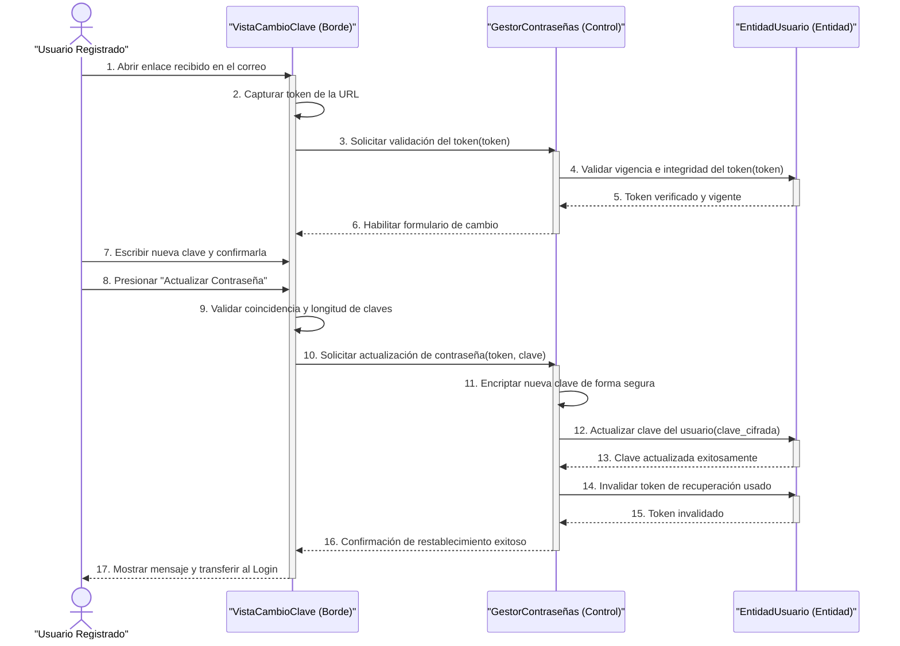

* **Excepción 1:** Token inválido/expirado → formulario bloqueado.
* **Excepción 2:** Contraseñas no coinciden → detenido localmente.

---

### **CU-05: Consultar Resumen y Balance**

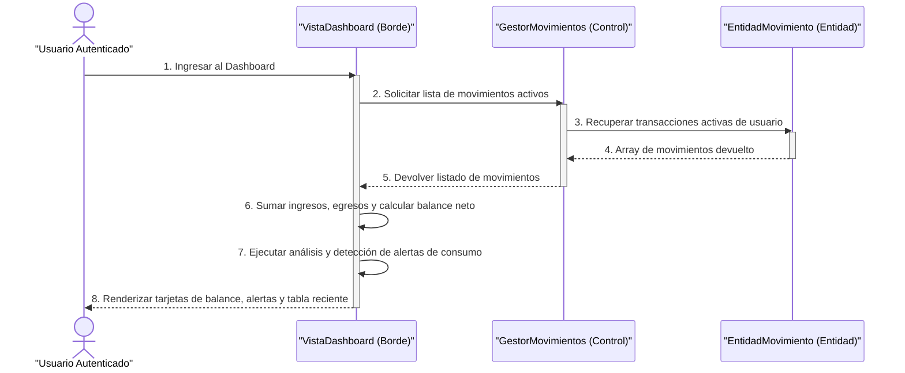

* **Excepción 1:** Sesión expirada → advertencia en rojo.
* **Excepción 2:** Sin transacciones → estado vacío con llamada a la acción.

---

### **CU-06: Registrar Movimiento Manual**

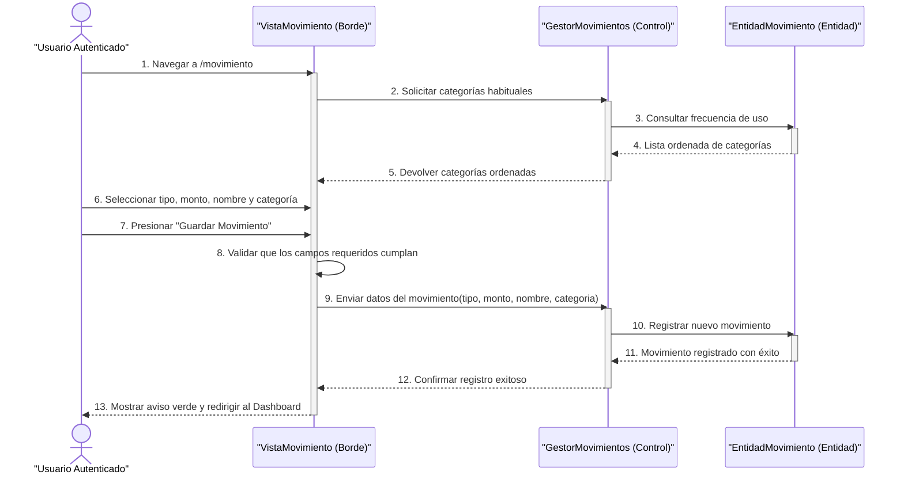

* **Excepción 1:** Campos obligatorios vacíos → bloqueo local.
* **Excepción 2:** Falla al guardar → aviso rojo de error de servidor.

---

### **CU-07: Cargar Comprobante por Imagen**

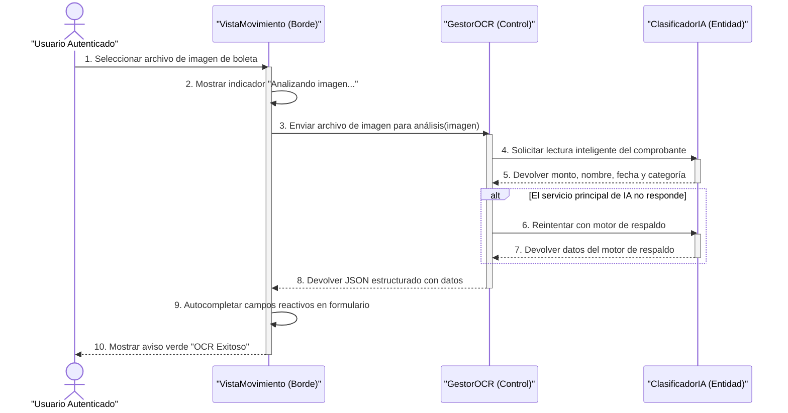

* **Excepción 1:** Ningún motor logra leer la imagen → campos vacíos, aviso naranja para completar a mano.
* **Excepción 2:** Usuario Free alcanzó su límite mensual gratuito de escaneos → el Gestor rechaza la solicitud y ofrece el Plan Pro.

---

### **CU-08: Desactivar Movimientos**

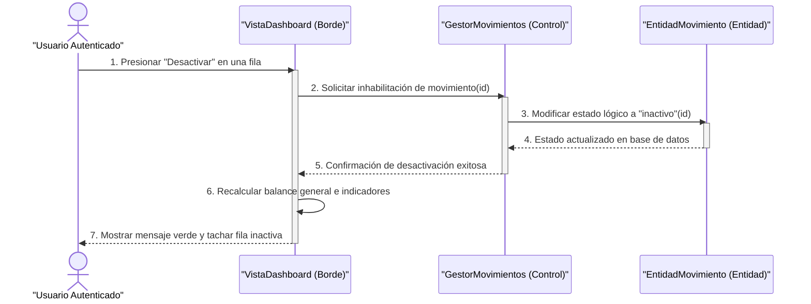

* **Excepción 1:** Movimiento pertenece a un periodo ya cerrado → el Gestor rechaza la desactivación.

---

### **CU-09: Visualizar Reportes y Gráficos**

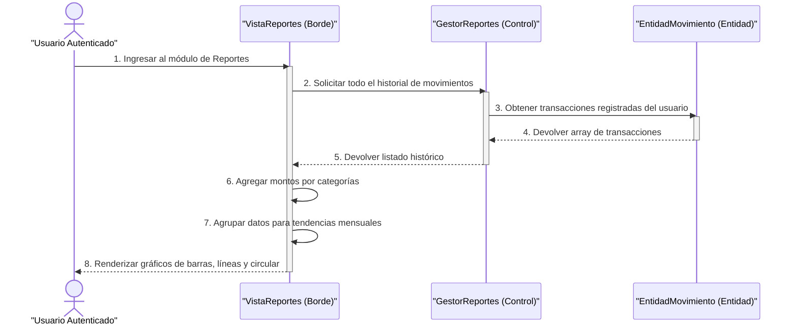

* **Excepción 1:** Sin datos de transacciones → vista especial de estado vacío.

---

### **CU-10: Filtrar Historial Completo**

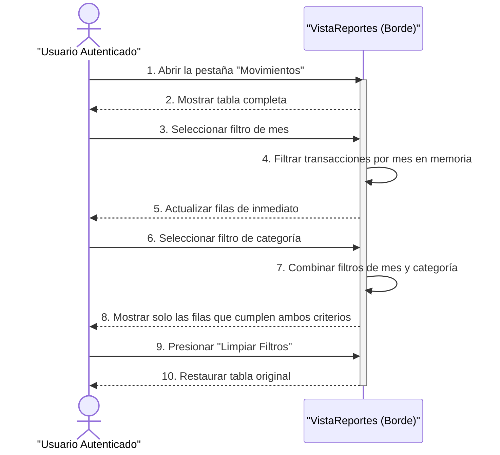

* Este caso de uso no involucra al Gestor/Control: el historial completo ya fue cargado previamente (CU-09) y el filtrado ocurre enteramente en memoria, dentro del propio navegador.
* **Excepción 1:** Filtros sin resultados → recuadro explicativo de "sin movimientos".

---

### **CU-11: Planificar Ahorro para Compra**

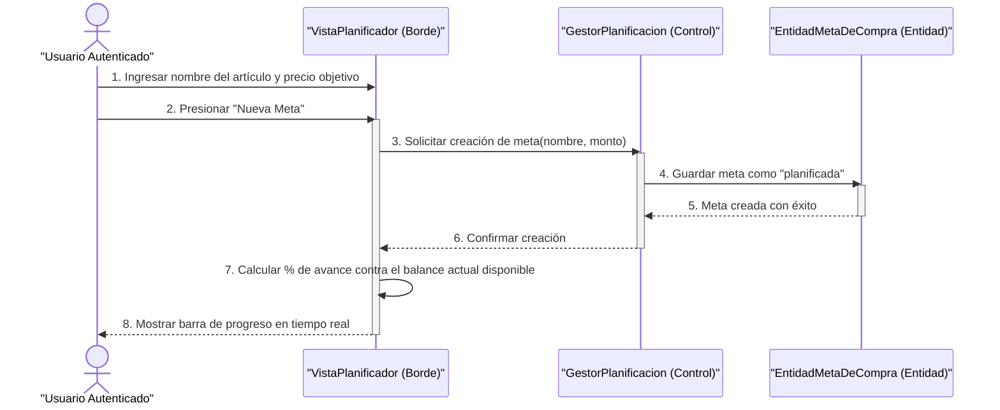

* **Excepción 1:** El balance ya alcanza el monto → la meta se marca "¡Lista para comprar!" automáticamente.
* **Excepción 2:** Nombre o monto inválido → bloqueo local antes de enviar al Gestor.

---

### **CU-12: Gestionar Información de Perfil**

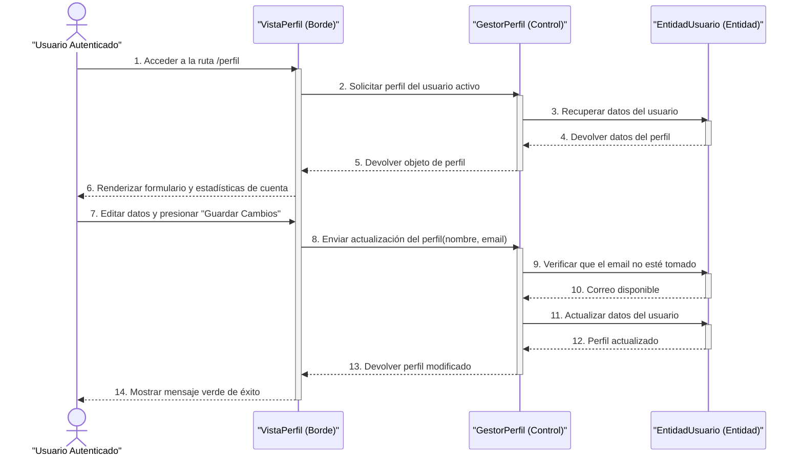

* **Excepción 1:** Campos vacíos → bloqueo local.
* **Excepción 2:** Correo ya usado por otra cuenta → conflicto, mensaje rojo.

---

### **CU-13: Cerrar Sesión**

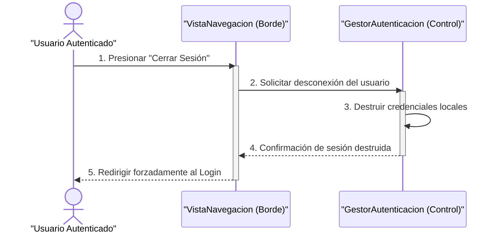

---

### **CU-14: Realizar Arqueo Diario**

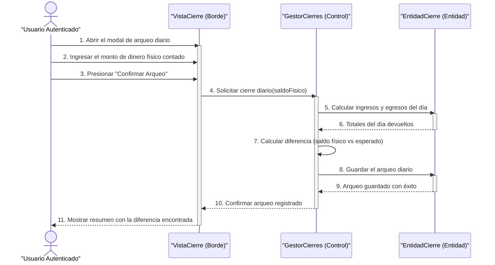

* **Excepción 1:** Campo de monto vacío → bloqueo local.
* **Excepción 2:** Ya existe un arqueo para el día → el Gestor rechaza el duplicado.

---

### **CU-15: Realizar Cierre Mensual**

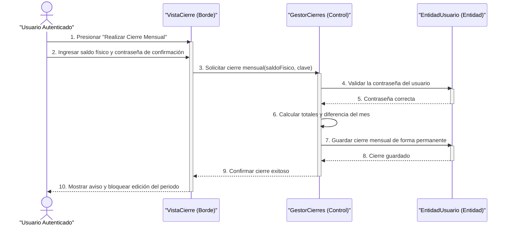

* **Excepción 1:** Contraseña incorrecta → el Gestor rechaza el cierre.

---

### **CU-16: Reabrir Periodo Cerrado**

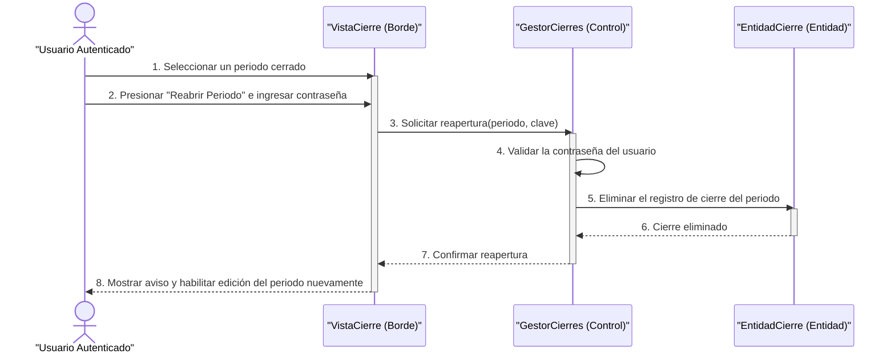

* **Excepción 1:** Contraseña incorrecta → se cancela la operación de seguridad.

---

### **CU-17: Destacar Ingreso Fijo**

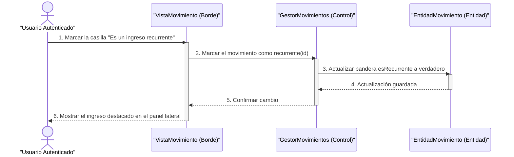

* **Excepción 1:** El usuario revoca la constancia → se repite el flujo invirtiendo la bandera a falso.

---

### **CU-18: Eliminar Cuenta**

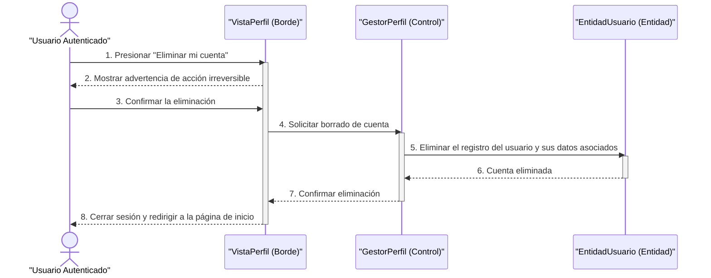

* **Excepción 1:** El usuario cancela la confirmación → no ocurre ninguna acción.

---

### **CU-19: Suscribirse al Plan Pro**

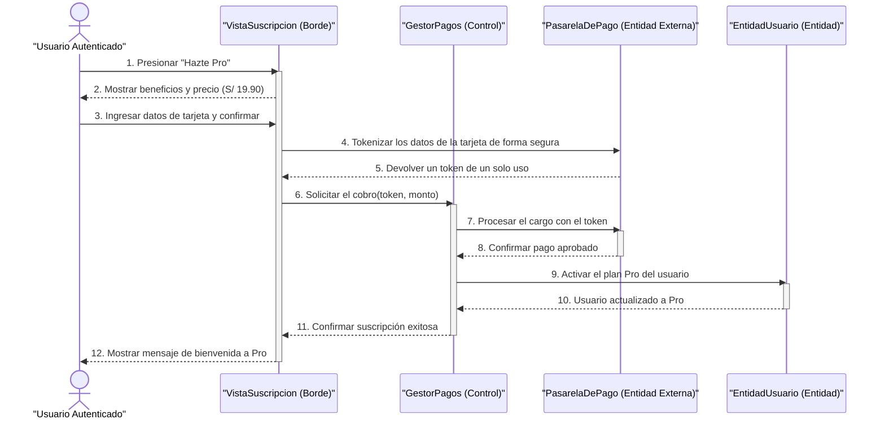

* **Excepción 1:** La tarjeta es rechazada → la Pasarela informa el motivo y no se activa el plan.
* **Excepción 2:** La pasarela no está disponible → el Gestor informa que el pago no pudo iniciarse.

---

### **CU-20: Gestionar Recordatorios de Préstamos**

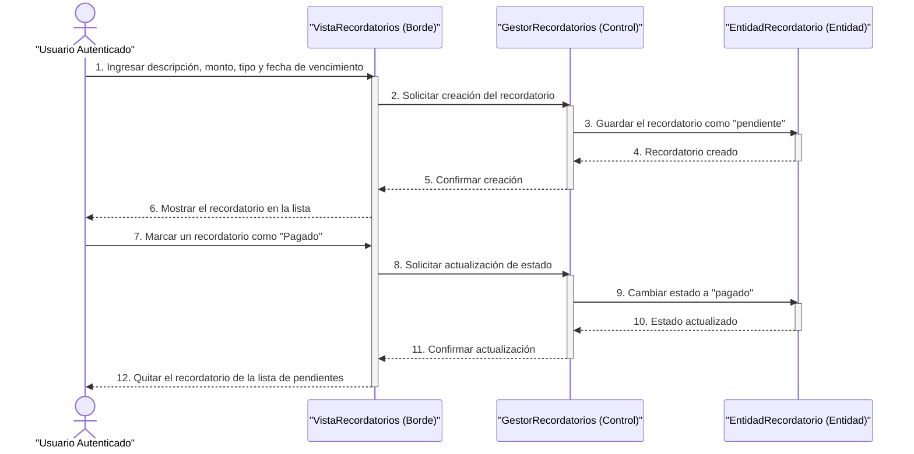

* **Excepción 1:** Fecha de vencimiento ya pasada → la Vista advierte pero permite continuar.

---

### **CU-21: Exportar Reportes en Excel/PDF**

```mermaid
sequenceDiagram
    actor Cliente as "Usuario Pro"
    participant Vista as "VistaReportes (Borde)"
    participant Gestor as "GestorReportes (Control)"
    participant Entidad as "EntidadMovimiento (Entidad)"

    Cliente->>Vista: 1. Presionar "Exportar Excel" o "Exportar PDF"
    activate Vista
    Vista->>Gestor: 2. Verificar que el usuario tenga el Plan Pro activo
    activate Gestor
    Gestor-->>Vista: 3. Confirmar que el plan es Pro
    deactivate Gestor
    Vista->>Entidad: 4. Obtener los movimientos actualmente filtrados
    activate Entidad
    Entidad-->>Vista: 5. Devolver listado de movimientos
    deactivate Entidad
    Vista->>Vista: 6. Generar el archivo (Excel o PDF) en el propio navegador
    Vista-->>Cliente: 7. Descargar el archivo contable generado
    deactivate Vista
```

* **Excepción 1:** El usuario no tiene el Plan Pro → en lugar de exportar, se muestra el aviso para suscribirse (CU-19).

---

### **CU-22: Administrar la Plataforma**

```mermaid
sequenceDiagram
    actor Admin as "Administrador"
    participant Vista as "VistaAdmin (Borde)"
    participant Gestor as "GestorAdministracion (Control)"
    participant Entidad as "EntidadUsuario / EntidadPago (Entidad)"

    Admin->>Vista: 1. Ingresar al Panel de Administración
    activate Vista
    Vista->>Gestor: 2. Solicitar métricas globales y lista de usuarios
    activate Gestor
    Gestor->>Entidad: 3. Consultar usuarios, pagos y totales del sistema
    activate Entidad
    Entidad-->>Gestor: 4. Devolver datos agregados
    deactivate Entidad
    Gestor-->>Vista: 5. Devolver panel de control completo
    deactivate Gestor
    Vista-->>Admin: 6. Mostrar métricas, usuarios y pagos pendientes
    Admin->>Vista: 7. Aprobar un pago manual (Yape/BCP) pendiente
    Vista->>Gestor: 8. Solicitar aprobación del pago(idPago)
    activate Gestor
    Gestor->>Entidad: 9. Marcar el pago como aprobado y activar el Plan Pro
    activate Entidad
    Entidad-->>Gestor: 10. Usuario actualizado
    deactivate Entidad
    Gestor-->>Vista: 11. Confirmar aprobación
    deactivate Gestor
    Vista-->>Admin: 12. Actualizar la lista de pagos pendientes
    deactivate Vista
```

* **Excepción 1:** El usuario autenticado no tiene rol de Administrador → el sistema le niega el acceso al panel.
