# Diagrama de Clases (Fase de Análisis) — FinanceFlow

Modelo de dominio conceptual bajo el patrón **BCE (Boundary-Control-Entity)**:

```mermaid
classDiagram
    %% --- Clases de Borde (Interfaces / Vistas) ---
    class VistaRegistro {
        <<boundary>>
        +capturarDatos()
        +mostrarMensajeExito()
    }
    class VistaLogin {
        <<boundary>>
        +capturarCredenciales()
        +redirigirDashboard()
    }
    class VistaDashboard {
        <<boundary>>
        +renderizarMetricas()
        +mostrarAlertas()
    }
    class VistaMovimiento {
        <<boundary>>
        +seleccionarComprobante()
        +capturarCamposManuales()
    }
    class VistaReportes {
        <<boundary>>
        +capturarFiltros()
        +renderizarGraficos()
        +solicitarExportacion()
    }
    class VistaPlanificador {
        <<boundary>>
        +capturarMeta()
        +mostrarProgreso()
    }
    class VistaCierre {
        <<boundary>>
        +capturarSaldoFisico()
        +capturarContraseña()
    }
    class VistaRecordatorios {
        <<boundary>>
        +capturarPrestamo()
        +marcarComoPagado()
    }
    class VistaSuscripcion {
        <<boundary>>
        +mostrarBeneficiosPro()
        +capturarDatosDePago()
    }
    class VistaPerfil {
        <<boundary>>
        +mostrarDatosPersonales()
        +confirmarEliminacion()
    }
    class VistaAdmin {
        <<boundary>>
        +mostrarMetricasGlobales()
        +listarPagosPendientes()
    }

    %% --- Clases de Control (Gestores Lógicos) ---
    class GestorRegistro {
        <<control>>
        +crearCuenta(nombre, email, clave)
    }
    class GestorAutenticacion {
        <<control>>
        +iniciarSesion(email, clave)
        +cerrarSesion()
    }
    class GestorContraseñas {
        <<control>>
        +solicitarRecuperacion(email)
        +actualizarClave(token, nuevaClave)
    }
    class GestorMovimientos {
        <<control>>
        +registrarMovimiento(tipo, nombre, monto, categoria)
        +inhabilitarMovimiento(id)
        +marcarComoRecurrente(id)
    }
    class GestorOCR {
        <<control>>
        +procesarImagenBoleta(imagen)
    }
    class GestorReportes {
        <<control>>
        +obtenerHistorialCompleto()
        +calcularTendenciasMensuales()
        +verificarAccesoPro()
    }
    class GestorPlanificacion {
        <<control>>
        +crearMetaDeCompra(nombre, monto)
        +calcularAvanceContraBalance()
    }
    class GestorCierres {
        <<control>>
        +realizarArqueoDiario(saldoFisico)
        +realizarCierreMensual(saldoFisico, clave)
        +reabrirPeriodo(periodo, clave)
    }
    class GestorRecordatorios {
        <<control>>
        +crearRecordatorio(descripcion, monto, fechaVencimiento)
        +marcarComoPagado(id)
    }
    class GestorPagos {
        <<control>>
        +procesarSuscripcion(token, monto)
        +consultarEstadoDelPlan()
    }
    class GestorPerfil {
        <<control>>
        +obtenerPerfil()
        +actualizarPerfil(nombre, email)
        +eliminarCuenta()
    }
    class GestorAdministracion {
        <<control>>
        +obtenerMetricasGlobales()
        +aprobarPagoManual(idPago)
        +alternarPlanDeUsuario(idUsuario)
    }

    %% --- Clases de Entidad ---
    class Usuario {
        <<entity>>
        +String nombre
        +String email
        +String claveCifrada
        +String rol
        +String plan
        +Boolean esPremium
        +validarClave(clave) Boolean
        +desactivarCuenta()
    }
    class Movimiento {
        <<entity>>
        +String tipo
        +String nombre
        +Double monto
        +String categoria
        +Date fecha
        +String estado
        +Boolean esRecurrente
        +inhabilitar()
    }
    class MetaDeCompra {
        <<entity>>
        +String nombre
        +Double montoObjetivo
        +String estado
        +calcularPorcentajeAvance(balance) Double
    }
    class Cierre {
        <<entity>>
        +String tipo
        +String periodo
        +Double saldoEsperado
        +Double saldoFisico
        +Double diferencia
    }
    class Recordatorio {
        <<entity>>
        +String tipo
        +String descripcion
        +Double monto
        +Date fechaVencimiento
        +String estado
    }
    class Pago {
        <<entity>>
        +String metodo
        +Double monto
        +String estado
        +String numeroDeOperacion
    }
    class PatronClasificacion {
        <<entity>>
        +List datosEntrenamiento
        +predecirCategoria(nombre) String
    }

    %% --- Relaciones de Asociación ---
    Usuario "1" *-- "many" Movimiento : posee
    Usuario "1" *-- "many" MetaDeCompra : planifica
    Usuario "1" *-- "many" Cierre : ejecuta
    Usuario "1" *-- "many" Recordatorio : registra
    Usuario "1" *-- "many" Pago : realiza
    MetaDeCompra "1" ..> "0..1" Movimiento : se convierte en
    Movimiento "many" --> "1" PatronClasificacion : clasificado por

    %% --- Relaciones Borde -> Control ---
    VistaRegistro ..> GestorRegistro : usa
    VistaLogin ..> GestorAutenticacion : usa
    VistaDashboard ..> GestorMovimientos : usa
    VistaMovimiento ..> GestorMovimientos : usa
    VistaMovimiento ..> GestorOCR : usa
    VistaReportes ..> GestorReportes : usa
    VistaPlanificador ..> GestorPlanificacion : usa
    VistaCierre ..> GestorCierres : usa
    VistaRecordatorios ..> GestorRecordatorios : usa
    VistaSuscripcion ..> GestorPagos : usa
    VistaPerfil ..> GestorPerfil : usa
    VistaAdmin ..> GestorAdministracion : usa

    %% --- Relaciones Control -> Entidad ---
    GestorRegistro ..> Usuario : crea
    GestorAutenticacion ..> Usuario : valida
    GestorContraseñas ..> Usuario : modifica
    GestorMovimientos ..> Movimiento : gestiona
    GestorOCR ..> PatronClasificacion : consulta
    GestorReportes ..> Movimiento : analiza
    GestorReportes ..> Usuario : verifica plan de
    GestorPlanificacion ..> MetaDeCompra : gestiona
    GestorCierres ..> Cierre : gestiona
    GestorCierres ..> Movimiento : congela
    GestorRecordatorios ..> Recordatorio : gestiona
    GestorPagos ..> Pago : registra
    GestorPagos ..> Usuario : actualiza plan de
    GestorPerfil ..> Usuario : modifica
    GestorAdministracion ..> Usuario : supervisa
    GestorAdministracion ..> Pago : aprueba
```

1. **`<<boundary>>`**: pantallas con las que interactúa el usuario.
2. **`<<control>>`**: gestores que aplican las reglas de negocio.
3. **`<<entity>>`**: datos persistentes del negocio.

## Descripción narrativa

1. **Capa de Borde**: pantallas (`Vista...`) que capturan la intención del usuario, validan formatos de forma local y renderizan resultados. No contienen reglas de negocio.
2. **Capa de Control**: los `Gestor...` son el "cerebro" del sistema — coordinan acciones, aplican reglas (p. ej. `GestorReportes` verifica si el usuario es Pro antes de permitir exportar) y hablan con las entidades.
3. **Capa de Entidad**: datos reales y persistentes.
   - **`Usuario`**: dueño de todo — posee Movimientos, planifica Metas, ejecuta Cierres, registra Recordatorios y realiza Pagos.
   - **`Movimiento`**: cada ingreso/egreso; puede marcarse recurrente o quedar "congelado" tras un Cierre.
   - **`MetaDeCompra`**: una planificación de ahorro que, al completarse, se convierte en un `Movimiento` real de tipo egreso.
   - **`Cierre`**: fotografía inmutable del balance de un día o un mes.
   - **`Recordatorio`**: dinero prestado u otorgado, independiente de los Movimientos.
   - **`Pago`**: el registro de cada intento de suscripción al Plan Pro, ya sea automático (pasarela) o manual (Yape/BCP aprobado por un Administrador).
   - **`PatronClasificacion`**: el motor que sugiere la categoría de un Movimiento a partir de su descripción.

**Composición (`1` a `many`)**: si el `Usuario` elimina su cuenta (CU-18), todos sus Movimientos, Metas, Cierres, Recordatorios y Pagos desaparecen con él — son existencialmente dependientes de su dueño.
