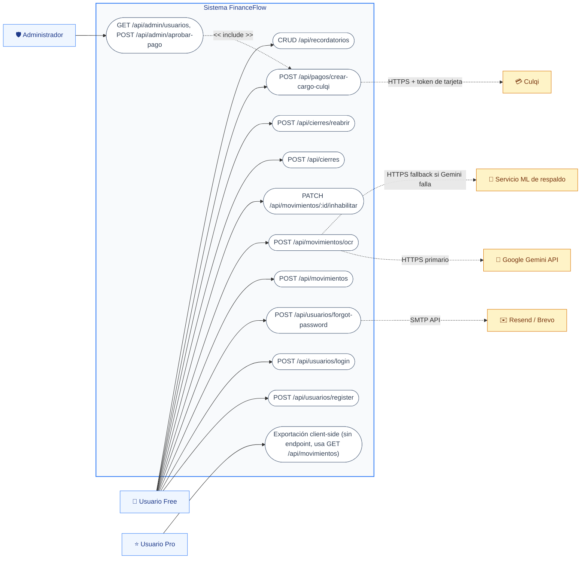

# Diagrama de Casos de Uso (Vista de Diseño) — FinanceFlow

A diferencia de la vista de análisis, aquí el diagrama incluye los **sistemas externos reales** con los que FinanceFlow se integra, y agrupa los casos de uso por el **endpoint REST** que realmente los implementa.

## Actores

| Actor | Tipo | Detalle técnico |
|---|---|---|
| Usuario Free | Humano | `Usuario.planTipo = "free"`, límite de OCR (`conteoOcrMes`) |
| Usuario Pro | Humano | `Usuario.esPremium = true`, `planTipo = "pro"` |
| Administrador | Humano | `Usuario.rol = "admin"`, validado por `middlewares/isAdmin.js` |
| Culqi | Sistema externo | API REST de cobro con tarjeta (`api.culqi.com/v2/charges`) |
| Google Gemini API | Sistema externo | `@google/generative-ai`, modelo de visión para OCR |
| Servicio ML de respaldo | Sistema externo | FastAPI + Tesseract + Naive Bayes (`ml_backend/`, Render) |
| Resend / Brevo | Sistema externo | Envío de correos (recuperación de contraseña) |
| Sentry | Sistema externo | Observabilidad y captura de errores (frontend + backend) |

## Notas técnicas de diseño

- `UC-07` implementa un patrón de **fallback de proveedor**: primero intenta `backend/services/ocr.service.js` (Gemini 1.5/2.0 Flash Vision); si la respuesta no es exitosa, `frontend/src/hooks/useImageToMovimiento.js` reintenta contra el microservicio Python desplegado por separado en Render (`financeflow-ml.onrender.com`).
- `UC-19` nunca recibe el número de tarjeta en el backend: el frontend lo tokeniza directamente con el script `checkout.culqi.com/js/v4` (Culqi Checkout) y solo el `source_id` (token) viaja al endpoint `crear-cargo-culqi`, protegido con `auth`.
- `UC-22` usa `req.user.id` del JWT + `middlewares/isAdmin.js`, nunca un rol enviado por el cliente.
