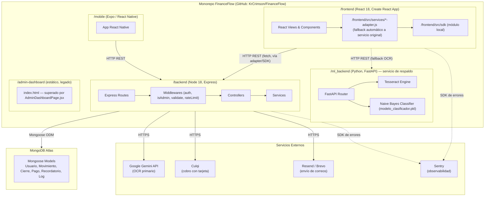

# Diagrama de Subsistemas (Paquetes Lógicos) — Vista de Diseño — FinanceFlow

## Explicación

- **`/frontend`** es una SPA de React servida estáticamente desde **Vercel**. No llama directamente a `fetch` en la mayoría de los módulos: pasa por un **adaptador** (`*-adapter.js`) que intenta usar el `sdk` local y cae de vuelta (fallback) al servicio original si el SDK falla — patrón de migración gradual, no un paquete npm externo real.
- **`/backend`** es la API REST única (Express) desplegada en **Render**, responsable de toda la lógica de negocio, autenticación y persistencia.
- **`/ml_backend`** es un **segundo servicio independiente**, también en Render, con su propio `Dockerfile`. Solo se usa como **respaldo** del OCR cuando Gemini no está disponible o la cuenta no tiene cuota.
- **`/mobile`** es una app Expo/React Native que consume la **misma** API REST del backend — no tiene lógica de negocio propia.
- **`/admin-dashboard`** es un artefacto estático legado; el panel de administración realmente usado hoy es `frontend/src/pages/AdminDashboardPage.jsx`, servido como parte de la SPA.
- Los 4 servicios externos (Gemini, Culqi, Resend/Brevo, Sentry) son llamados exclusivamente desde el backend, **excepto** la tokenización de tarjeta de Culqi, que ocurre en el navegador del cliente antes de llegar al backend (por requerimiento de PCI-DSS de Culqi).
