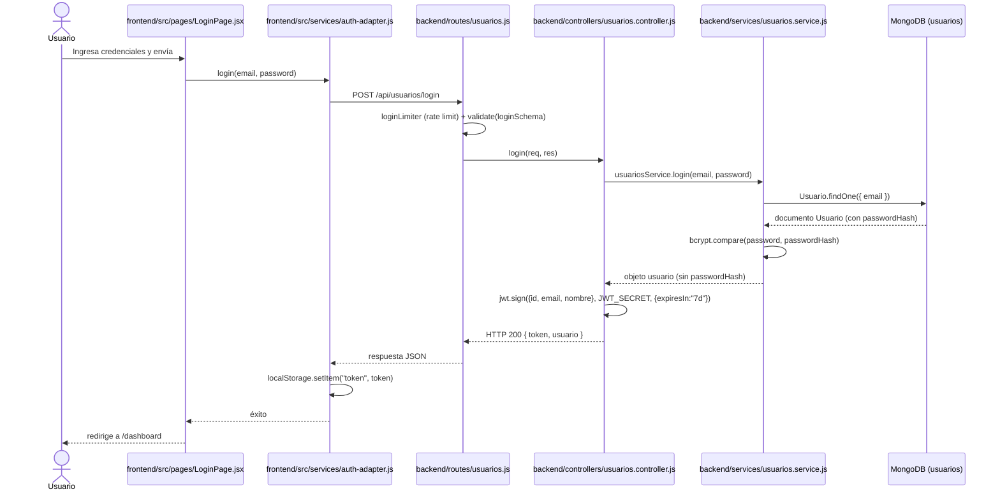
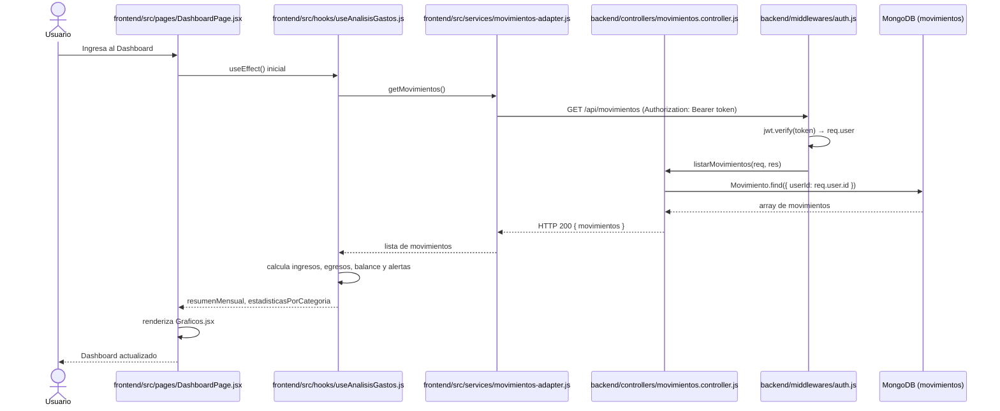
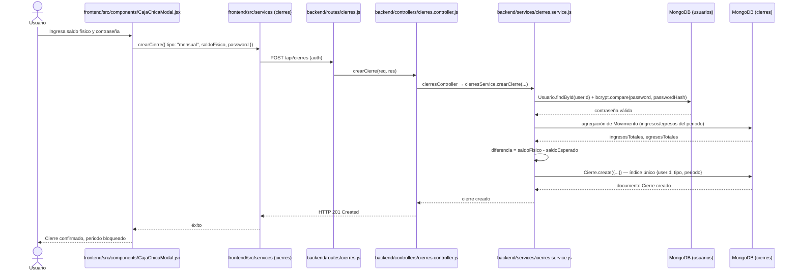
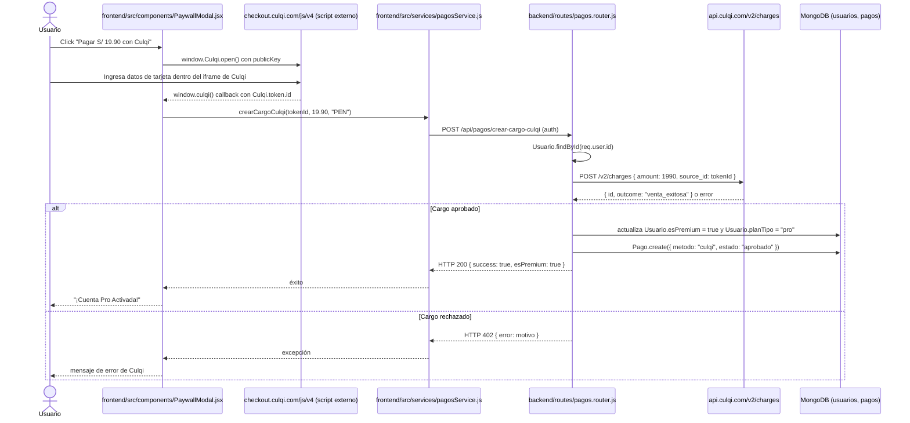

# Diagramas de Secuencia (Vista de Diseño) — FinanceFlow

Diagramas técnicos con **nombres reales de archivos, rutas HTTP y módulos** del código fuente actual.

---

## 1. Autenticación de Usuario (Login)

---

## 2. Visualización del Dashboard

---

## 3. Realizar Cierre Mensual

---

## 4. Suscripción al Plan Pro con Culqi

