# Diagrama de Colaboración (Vista de Diseño) — FinanceFlow

Representa el mismo flujo del **CU-07 (Cargar Comprobante por Imagen)** pero en notación de colaboración: objetos conectados con mensajes numerados, mostrando el patrón de **fallback entre dos proveedores de OCR**.

```mermaid
flowchart LR
    Usuario((Usuario)) -->|"1: selecciona imagen"| UI["frontend/src/pages/MovimientoFormPage.jsx"]
    UI -->|"2: processImage(file)"| Hook["frontend/src/hooks/useImageToMovimiento.js"]
    Hook -->|"3: POST /api/movimientos/ocr"| Ctrl["backend/controllers/movimientos.controller.js"]
    Ctrl -->|"4: analizarComprobante(base64)"| OcrSvc["backend/services/ocr.service.js"]
    OcrSvc -->|"5: generateContent(imagen, prompt)"| Gemini["Google Gemini API"]
    Gemini -.->|"6a: JSON {monto, nombre, categoria}"| OcrSvc
    OcrSvc -.->|"6b: timeout / error"| Ctrl
    Ctrl -.->|"7: HTTP 200 o error"| Hook
    Hook -->|"8 (solo si 7 fue error): POST /analyze-receipt"| ML["ml_backend/main.py (FastAPI)"]
    ML -->|"9: Tesseract + Naive Bayes"| Modelo["modelo_clasificador.pkl"]
    Modelo -.->|"10: categoria_ml, monto"| ML
    ML -.->|"11: JSON de respaldo"| Hook
    Hook -->|"12: setResult(datos)"| UI
    UI -->|"13: autocompleta formulario"| Usuario
    UI -->|"14: submit"| Adapter["frontend/src/services/movimientos-adapter.js"]
    Adapter -->|"15: POST /api/movimientos"| CtrlMov["backend/controllers/movimientos.controller.js"]
    CtrlMov -->|"16: crearMovimiento()"| Model["backend/database/movimiento.model.js"]
    Model -->|"17: insert"| DB[(MongoDB)]
```

## Lectura del diagrama

1–7: el frontend intenta primero el camino **Gemini** (vía el propio backend de Express, que es quien posee la `GEMINI_API_KEY`).
8–11: **solo si el paso 7 falla** (timeout, cuota agotada, error), el hook `useImageToMovimiento.js` recurre por su cuenta al microservicio **ml_backend**, alojado por separado y con su propio modelo entrenado (Naive Bayes + Tesseract OCR).
12–13: cualquiera de los dos resultados autocompleta el mismo formulario — el usuario no distingue cuál motor respondió.
14–17: el guardado final del movimiento siempre pasa por el mismo camino (Express → Mongoose → MongoDB), independientemente de qué motor de OCR se usó.
