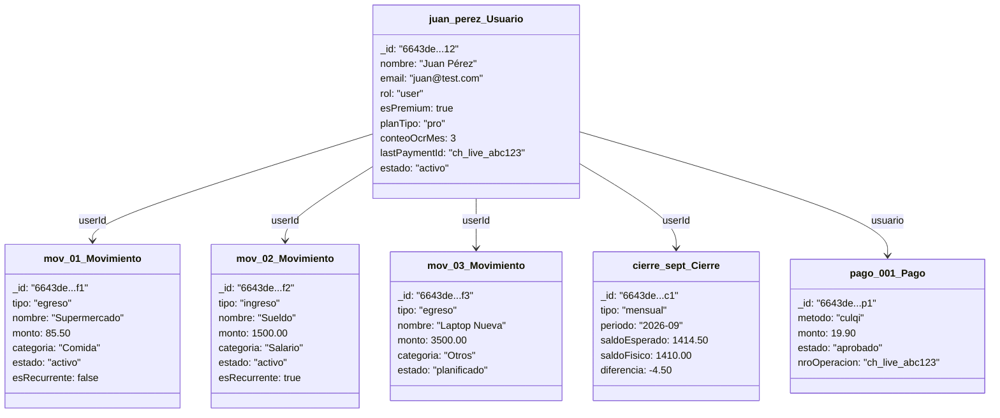

# Diagrama de Objetos (Vista de Diseño) — FinanceFlow

Fotografía de una instancia real del sistema en un momento dado: un usuario Pro, con movimientos, una meta de compra, un cierre y un pago ya procesado.

## Lectura del estado

- `juan_perez_Usuario.esPremium = true` porque `pago_001_Pago.estado = "aprobado"` fue el que disparó la actualización (ver secuencia de diseño #4).
- `mov_03_Movimiento.estado = "planificado"` es la meta de compra "Laptop Nueva" — todavía no se convirtió en un egreso real porque su `estado` no es `"activo"`.
- `mov_02_Movimiento.esRecurrente = true` indica que este ingreso se volverá a crear automáticamente cada mes (CU-17).
- `cierre_sept_Cierre.diferencia = -4.50` es negativa, lo que indica un faltante de caja de S/ 4.50 encontrado en el arqueo de septiembre 2026.
