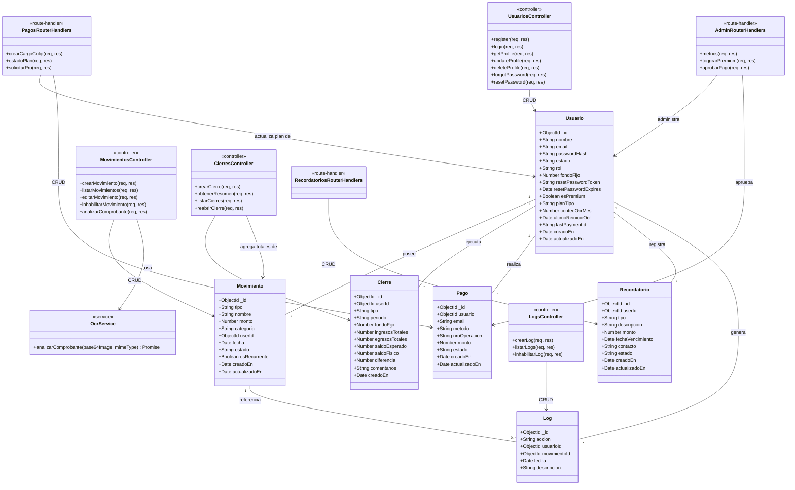

# Diagrama de Clases (Vista de Diseño) — FinanceFlow

Clases técnicas con los **tipos de dato exactos** de los esquemas Mongoose (`backend/database/*.model.js`) y los módulos de la capa Controller/Service que los manipulan.

## Enums, valores por defecto y claves foráneas (detalle)

El diagrama mantiene los nombres de campo limpios para que las cajas no se desborden; aquí está el detalle completo de cada restricción real del esquema Mongoose:

| Clase | Campo | Detalle |
|---|---|---|
| Usuario | `email` | único (`unique: true`), en minúsculas |
| Usuario | `estado` | enum `activo \| inactivo` |
| Usuario | `rol` | enum `user \| admin` |
| Usuario | `fondoFijo` | default `1000` |
| Usuario | `esPremium` | default `false` |
| Usuario | `planTipo` | enum `free \| pro` |
| Usuario | `conteoOcrMes` | default `0` |
| Movimiento | `tipo` | enum `ingreso \| egreso` |
| Movimiento | `userId` | FK → `Usuario._id` |
| Movimiento | `estado` | enum `activo \| inactivo \| planificado` |
| Movimiento | `esRecurrente` | default `false` |
| Cierre | `userId` | FK → `Usuario._id` |
| Cierre | `tipo` | enum `diario \| mensual` |
| Cierre | `periodo` | formato `YYYY-MM-DD` (diario) o `YYYY-MM` (mensual) |
| Cierre | — | índice único compuesto: `{ userId, tipo, periodo }` |
| Pago | `usuario` | FK → `Usuario._id` |
| Pago | `metodo` | enum `yape \| bcp \| culqi \| card` |
| Pago | `monto` | default `19.90` |
| Pago | `estado` | enum `pendiente \| aprobado \| rechazado` |
| Recordatorio | `userId` | FK → `Usuario._id` |
| Recordatorio | `tipo` | enum `prestamo_recibido \| prestamo_otorgado \| pago_pendiente` |
| Recordatorio | `estado` | enum `pendiente \| pagado` |
| Log | `usuarioId` | FK → `Usuario._id` |
| Log | `movimientoId` | FK → `Movimiento._id`, opcional (`required: false`) |

## Nota de arquitectura (deuda técnica real)

A diferencia de `usuarios`, `movimientos`, `cierres` y `logs` — que sí separan **Router → Controller → Service → Model** — los módulos **`pagos.router.js`**, **`admin.router.js`** y **`recordatorios.js`** implementan la lógica **directamente en el archivo de rutas**, sin un Controller ni Service dedicados. Esto se documenta tal cual está en el código (no se idealiza), ya que refleja fielmente el estado real del sistema.
