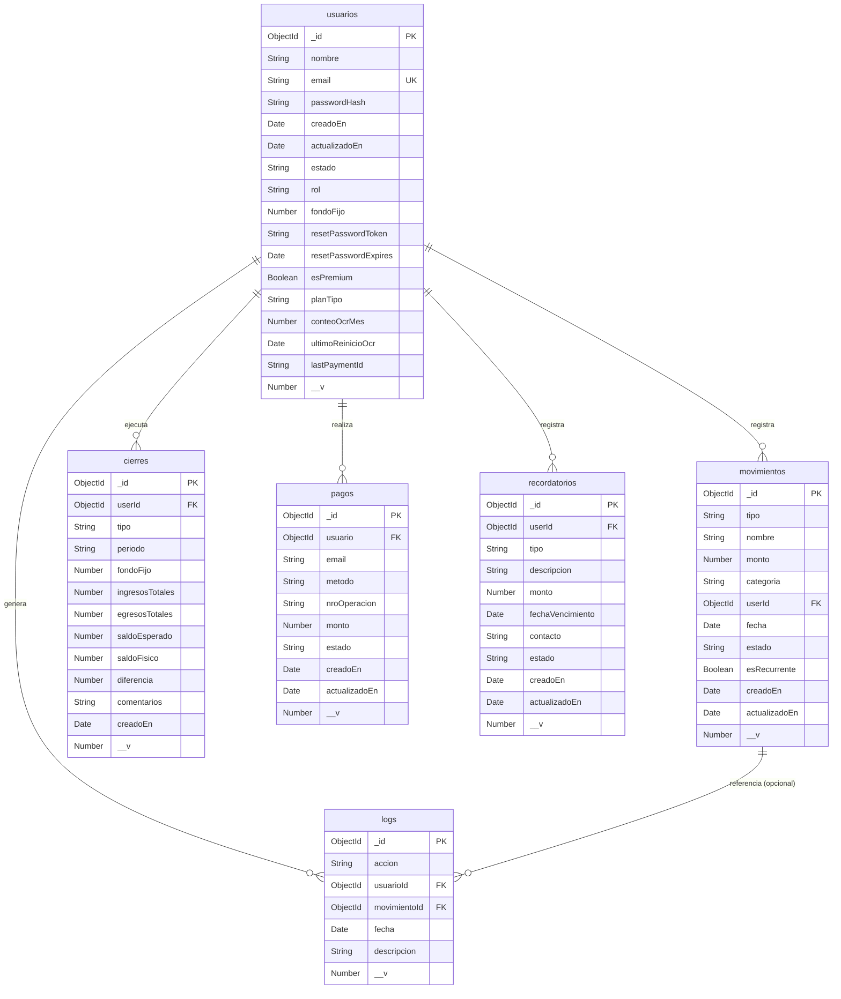

# Diagrama de Base de Datos (Entidad-Relación) — FinanceFlow

MongoDB Atlas, modelado con Mongoose. Refleja 1:1 los 6 esquemas reales en `backend/database/*.model.js`.

## Restricciones e índices reales

- `usuarios.email`: índice único (`unique: true`), siempre en minúsculas (`lowercase: true`).
- `cierres`: índice compuesto único `{ userId: 1, tipo: 1, periodo: 1 }` — impide crear dos cierres del mismo tipo para el mismo periodo (evita doble cierre mensual).
- `movimientos.estado`: enum estricto `['activo', 'inactivo', 'planificado']` — el valor `'planificado'` es el que sostiene la funcionalidad del Planificador de Compras (CU-11).
- `pagos.metodo`: enum `['yape', 'bcp', 'culqi', 'card']` — ampliado para soportar el cobro automático con Culqi y el flujo de desarrollo `checkout-directo`, además de las solicitudes manuales por Yape/BCP.
- `logs.movimientoId`: `required: false` — un log puede existir sin estar atado a un movimiento específico (ej. acciones de perfil o de sesión).
