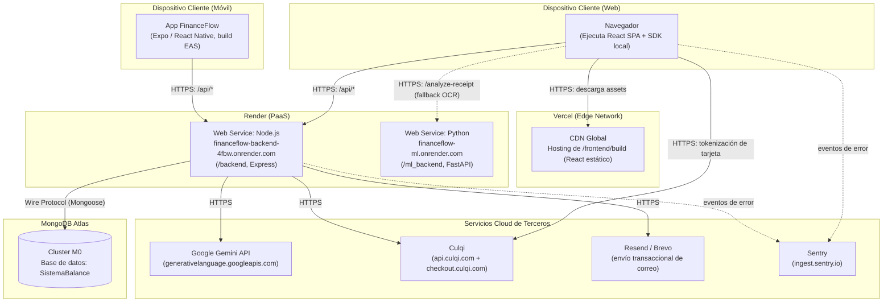

# Diagrama de Despliegue — FinanceFlow

## Notas de despliegue reales

- **Frontend**: desplegado en **Vercel**, `buildCommand: cd frontend && npm run build`, `outputDirectory: frontend/build`. Variables de entorno clave: `REACT_APP_API_URL`, `REACT_APP_CULQI_PUBLIC_KEY`, `REACT_APP_ML_URL`, `REACT_APP_SENTRY_DSN`.
- **Backend**: desplegado en **Render** como Web Service de Node.js independiente. Variables de entorno: `MONGODB_URI`, `JWT_SECRET`, `CULQI_SECRET_KEY`, `GEMINI_API_KEY`, `RESEND_API_KEY`/`BREVO_API_KEY`, `SENTRY_DSN`, `CORS_ORIGIN`.
- **ml_backend**: desplegado en Render como un **segundo y separado** Web Service de Python (tiene su propio `Dockerfile`), independiente del ciclo de vida del backend Node — puede caerse sin afectar el resto del sistema, ya que el frontend lo trata como respaldo opcional.
- **MongoDB Atlas**: clúster compartido M0 con "Network Access" abierto a `0.0.0.0/0` (según `DEPLOY_BACKEND.md`); el acceso real se restringe por usuario/contraseña de la cadena de conexión.
- **Mobile**: la app Expo se compila con **EAS Build** (`mobile/eas.json`) y consume la misma URL pública del backend en Render — no tiene despliegue propio de servidor.
- Todos los servicios de terceros (Gemini, Culqi, Resend/Brevo, Sentry) son **SaaS externos**, fuera de la infraestructura propia; FinanceFlow no aloja ninguno de ellos.
