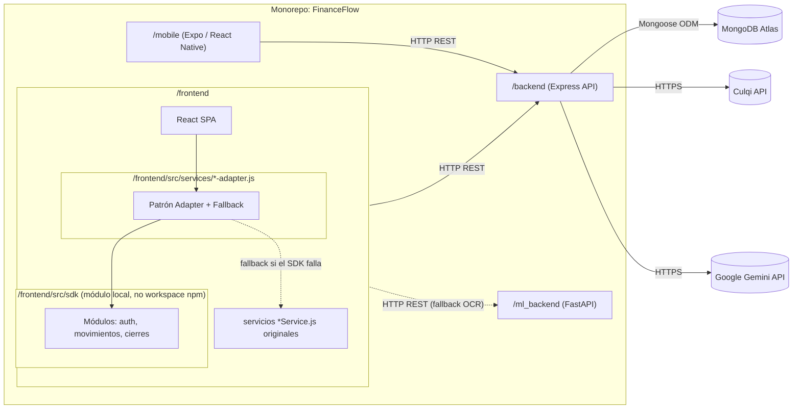

# Diagrama de Arquitectura Software (Paquetes) — FinanceFlow

## Explicación

- El **SDK no es un paquete npm publicado**: es una carpeta local (`frontend/src/sdk`) importada por rutas relativas. La raíz del repositorio (`/sdk`) contiene documentación de fases de una migración (`FASE1-COMPLETADA.md` … `FASE5-PLAN.md`) hacia convertirlo en un paquete real, pero **el código en producción usa la copia local dentro de `/frontend`**, no el paquete de la raíz.
- El patrón **Adapter + Fallback** (`movimientos-adapter.js`, `auth-adapter.js`, etc.) permite activar o desactivar el SDK nuevo con una bandera, sin romper el comportamiento ya probado del servicio original.
- `/backend` es el único paquete que posee credenciales de los servicios externos (Culqi, Gemini) — el frontend nunca llama a estas APIs directamente, con la única excepción de la tokenización de tarjeta de Culqi (por diseño de seguridad PCI del propio proveedor).
- `/ml_backend` es un paquete **desacoplado en su propio lenguaje (Python)**, consumido únicamente como contingencia cuando el backend de Node no puede resolver el OCR con Gemini.
