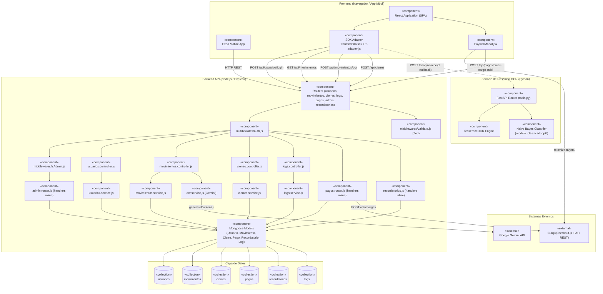

# Diagrama de Arquitectura del Sistema (Componentes) — FinanceFlow

## Notas

- Los tres componentes marcados como **"handlers inline"** (`pagos.router.js`, `admin.router.js`, `recordatorios.js`) no siguen la separación Controller/Service del resto del sistema — es deuda técnica real documentada, no un error de este diagrama.
- `OcrSvc` (Gemini) y `FastAPIRouter` (servicio de respaldo) son **mutuamente independientes**: ninguno conoce al otro. La decisión de usar uno u otro vive enteramente en el frontend (`useImageToMovimiento.js`), no en el backend.
- `PaywallUI` es el único componente de frontend con una conexión HTTPS directa a un sistema externo (Culqi), por el requisito de tokenización segura de tarjetas que exige esa pasarela.
