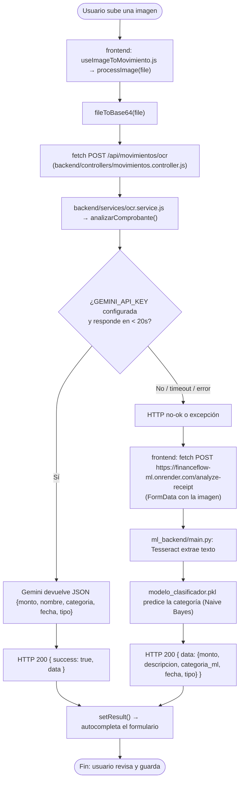
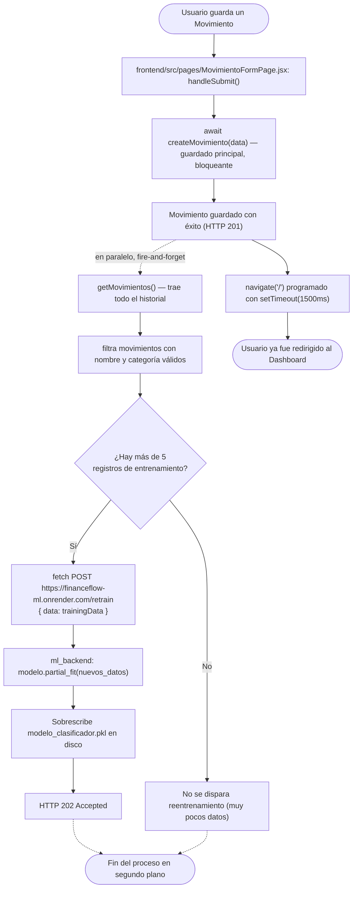

# Diagrama de Procesos del Sistema (Diagrama de Actividad) — FinanceFlow

Dos procesos asíncronos reales que corren en segundo plano, con nombres técnicos exactos.

---

## Proceso 1 — OCR con fallback de proveedor

---

## Proceso 2 — Silent Training (reentrenamiento silencioso en segundo plano)

## Notas de diseño

- Ambos procesos son **"fire-and-forget"** desde la perspectiva del usuario: el proceso 2 nunca bloquea la navegación — su resultado (éxito o fallo del reentrenamiento) se registra solo en la consola del navegador (`console.warn`), nunca se muestra en la interfaz.
- El proceso 1 tiene un **límite duro de 20 segundos** (`AbortController` + `setTimeout`) en el lado de Gemini antes de considerar que falló y activar el camino de respaldo — evita que el usuario quede esperando indefinidamente.
- El modelo `modelo_clasificador.pkl` del proceso 2 es el **mismo archivo** que usa el motor de respaldo del proceso 1 (`NaiveBayes` en `ml_backend`) — es decir, cada movimiento que el usuario guarda mejora silenciosamente la precisión del OCR de respaldo para futuras boletas.
